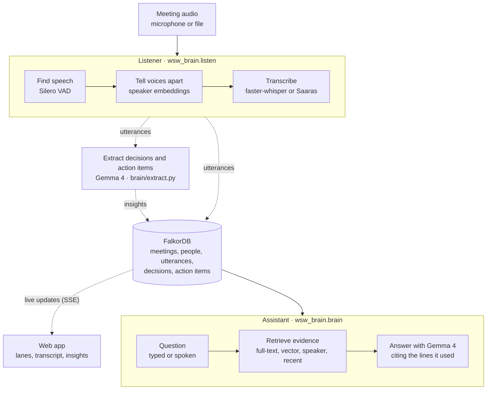
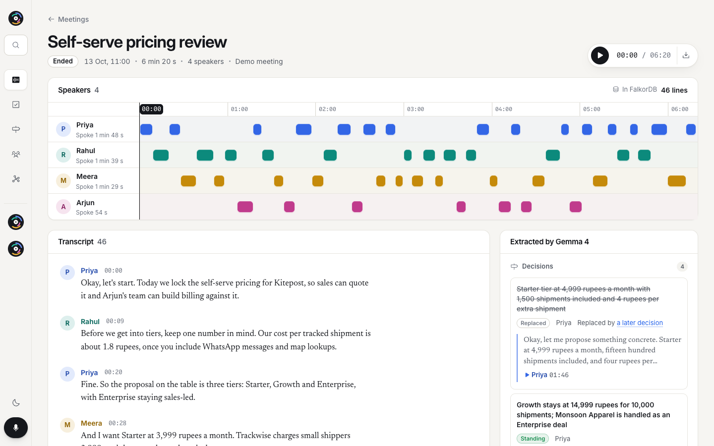
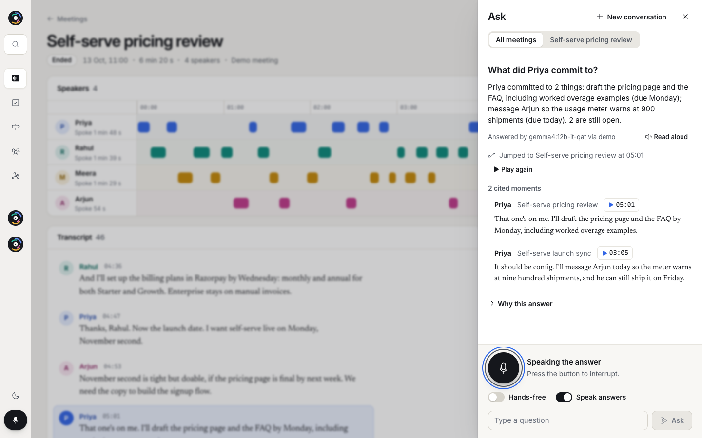
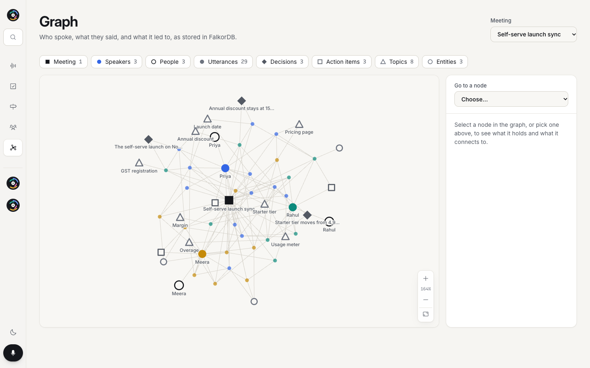

# On Record

<p align="center">
  
</p>

A meeting assistant that connects what was said to the person who said it. It keeps a meeting's transcript attributed to each speaker, pulls out the decisions and action items, and answers questions about past meetings with the quotes that back them up.

This repository is being assembled in feature-sized PRs from [Who Said What Brain](https://github.com/Hydra-Of-Malice/hack-october-who-said-what-brain). It currently includes shared Python contracts, graph storage and queries, audio decoding and transcription, text embeddings, hybrid meeting retrieval, local and hosted text model adapters, document search, the live listener, the web interface, and an HTTP app with the event stream. The meeting API and the assistant are still to come, so the web app runs on two bundled demo meetings; [the architecture notes](docs/ARCHITECTURE.md#what-is-not-in-the-repository-yet) list what is missing.

## How it works

On Record turns meeting audio into a graph of who said what, then answers questions from that graph, quoting the lines it used as evidence.



Dashed links are designed but not connected yet. Nothing writes the listener's utterances or the extractor's insights to the graph so far (`scripts/seed_demo_meetings.py` loads the demo meetings directly), and the web app still runs on its bundled demo data. [The architecture notes](docs/ARCHITECTURE.md) have the component diagram, the data flows and the graph schema.

## Screenshots

The web app running on its bundled demo meetings (`npm run dev`, 1440 × 900). They were captured in Chrome with reduced motion turned on, so nothing is mid-animation; retake them the same way when the UI changes.

<p align="center">
  
  <br><em>The meeting room: who spoke when, the transcript, and what Gemma 4 extracted.</em>
</p>

<table>
  <tr>
    <td width="50%"></td>
    <td width="50%"></td>
  </tr>
  <tr>
    <td><em>Ask: answers cite the exact lines, and each quote plays.</em></td>
    <td><em>The graph: what FalkorDB stores for a meeting.</em></td>
  </tr>
</table>

## Quick start

You need Node 20.19 or 22.12 and later for the web app, [uv](https://docs.astral.sh/uv/) for the Python backend (it installs Python 3.12), and Docker or Colima for the graph database. If a step fails, see [the troubleshooting guide](docs/TROUBLESHOOTING.md).

### Web app

```bash
cd apps/web
npm ci
npm run dev        # http://localhost:5173
```

It has a landing page with a 3D turntable pressed from a demo meeting, and the app: meetings, the meeting room (speaker lanes, transcript and extracted decisions and action items), commitments, decisions, people, the graph, and spoken questions. `npm run build` type-checks and builds; `npm run lint` runs oxlint.

### Backend

From the repository root:

```bash
cp .env.example .env    # optional; see docs/CONFIGURATION.md
uv sync --project apps/api --frozen
uv run --project apps/api python -c "from wsw_brain.brand import product_name; print(product_name())"
```

### Local Gemma runtime

The brain package can run Gemma 4 through Ollama without a hosted API key. The helper starts Ollama and pulls the configured model on first use:

```bash
./scripts/gemma.sh
uv run --project apps/api python scripts/bench_gemma.py --provider fake
```

Use `--provider ollama` for a live local benchmark. See [the local Gemma guide](docs/LOCAL_GEMMA.md) for provider settings, model choices, and report fields.

### Graph database

```bash
docker compose up -d --wait falkordb
```

FalkorDB is available at `127.0.0.1:6379`, with its browser at <http://localhost:3000>. Both ports bind to this machine only. Database files are kept in the `falkordb_data` volume when the container stops. If you use Colima without making it your default Docker context, use `docker --context colima compose` for these commands.

### Checks

CI (`.github/workflows/checks.yml`) runs the Python tests and lint with FalkorDB running:

```bash
uv run --project apps/api pytest -q
uv run --project apps/api ruff check apps/api/wsw_brain apps/api/tests
```

Without the database, `test_graph.py` is skipped, but `test_graph_schema.py`, `test_retrieve_graph.py` and `test_documents_ingest.py` fail. All four are marked `live`, so `pytest -q -m "not live"` runs the rest without FalkorDB.

CI does not check the web app yet; run `npm run lint` and `npm run build` in `apps/web` before opening a PR.

## Repository map

| Path | What it holds |
| --- | --- |
| `apps/web/` | The web app: landing page and the app (React, Vite, TypeScript). See [its README](apps/web/README.md) |
| `apps/web/scripts/` | Builds the demo data and, with Blender, the 3D landing assets |
| `apps/api/wsw_brain/` | The Python package: `contracts`, `config`, `events`, `graph`, `listen`, `brain`, `documents`, and the HTTP `app`, `event_stream` and `cli` launcher |
| `apps/api/tests/` | The pytest suite; `fixtures/` holds small synthetic ONNX models |
| `scripts/` | Loads the demo meetings into the graph and generates a demo PDF |
| `docs/` | The documentation listed below |
| `brand.json` | The display name, tagline and event details |
| `.env.example` | Every setting, with example values. Copy it to `.env`, which git ignores |
| `docker-compose.yml` | The FalkorDB service |

## Documentation

The [documentation index](docs/README.md) lists every document, including the requirements specification, architecture and design descriptions, API reference, test plan, threat model, [user guide](docs/user-guide.md) and [glossary](docs/glossary.md).

- [Architecture](docs/ARCHITECTURE.md): how the web app, the API and the graph fit together, the data flows, and the graph schema.
- [Configuration](docs/CONFIGURATION.md): every environment variable, its default, and what reads it.
- [Troubleshooting](docs/TROUBLESHOOTING.md): Docker, Colima, Node and Python setup problems.
- [Local Gemma runtime](docs/LOCAL_GEMMA.md): Ollama setup, provider selection and the smoke benchmark.
- [Design](docs/DESIGN.md): the visual design, tokens and motion.
- [Web app](apps/web/README.md): routes, demo mode and rebuilding the 3D assets.
- [Source notes](docs/UPSTREAM.md): the original snapshot and attribution.

## Backend modules

How to use each part of `wsw_brain`. The settings they read are listed in [CONFIGURATION.md](docs/CONFIGURATION.md).

### HTTP API

Start the dependency-free API shell locally with:

```bash
uv run --project apps/api python -m wsw_brain
```

The launcher binds to `127.0.0.1:8000` by default; pass `--host`, `--port`, or `--reload` for local development overrides.

`GET /healthz` returns `{"status":"ok"}` for process health checks. `GET /api/status` returns the product identity without connecting to FalkorDB or loading a model, and `GET /api/capabilities` lists the API version and the features it serves. `GET /api/events` streams the event bus as Server-Sent Events: `since_id` resumes after the last event id seen, and `meeting_id` limits the stream to one meeting. Feature routes can be mounted on the same app as they are added.

### Offline text embeddings

`HashEmbedder` converts meeting text and search queries into repeatable, normalised vectors without a model download. It uses word and word-pair overlap, so it is useful for local tests and offline search; it does not provide a language model's semantic understanding. Its tokenizer handles ASCII letters and digits. Empty or punctuation-only text receives a fixed unit vector so it remains valid for cosine indexes.

```bash
uv run --project apps/api python -c "from wsw_brain.brain import HashEmbedder; e = HashEmbedder(); print(e.name, len(e.embed_query('pricing deck')))"
```

The default dimension is 768. Pass a positive integer to `HashEmbedder(dim)` to match an existing vector index.

### Model-backed text embeddings

`GemmaEmbedder` runs EmbeddingGemma-300m on the CPU. It applies the model's separate document and query prompts, batches documents, and normalises vectors after truncating them to the requested dimension (up to the model's native width).

```python
from wsw_brain.brain import GemmaEmbedder

embedder = GemmaEmbedder()
documents = embedder.embed_documents(["The pricing deck is due Friday."])
query = embedder.embed_query("When is the pricing deck due?")
```

The first use downloads the quantised ONNX model and tokenizer into `WSW_MODELS_DIR` (default: `models/`). Later runs reuse those files. `WSW_EMBED_REPO` chooses the model repository and `WSW_EMBED_DIM` sets the requested vector width. The tokenizer truncates input to 256 tokens by default; documents are processed in batches of 16. The adapter also accepts `threads`, `max_tokens`, and `batch_size` options, all positive integers. No hosted inference API is required.

Application code can call `get_embedder()` from `wsw_brain.brain` to use `WSW_EMBEDDER=gemma` (the default) or `WSW_EMBEDDER=hash`. Missing external weights trigger one attempt to resume the download. If model loading still fails, it logs the cause and returns `HashEmbedder` at the configured dimension. The selected instance is cached for the process lifetime, including a fallback instance; restart the process after changing provider settings or repairing a failed model download. Direct `GemmaEmbedder()` construction raises loading errors if fallback is not wanted.

Model and hash vectors use different embedding spaces. When changing providers, use a separate graph or rebuild stored embeddings; matching vector dimensions alone does not make them compatible.

### Hybrid meeting retrieval

`Retriever` combines full-text and vector matches with reciprocal-rank fusion, counting each utterance once per source. Questions mentioning a known speaker also search that person's utterances; phrases such as "just now" add the newest utterances. The results keep the meeting, speaker, timestamps, text, and retrieval source needed for citations, alongside the Cypher queries that produced the evidence. Fused scores are relative to the best result, which scores 1.0; they are not confidence probabilities.

With a running database and meetings indexed using the same embedder:

```python
from wsw_brain.brain import Retriever, get_embedder
from wsw_brain.config import settings
from wsw_brain.graph import GraphStore

config = settings()
store = GraphStore(config.falkordb_url, config.graph)
try:
    retriever = Retriever(store, get_embedder())
    hits, cypher = retriever.retrieve("What did Priya say about pricing?", k=5)
    # Pass meeting_id="..." to restrict every search source to one meeting.
finally:
    store.close()
```

Blank questions return no results. `k` must be a positive integer. A failed query embedder or search source is logged, while the remaining sources still contribute results. Speaker names are cached for 30 seconds. Vector compatibility checks sample at most two meetings per query and cache verdicts for ten minutes; confirmed incompatible meetings are excluded from vector results. These checks are best effort: unverified hits stay eligible, and they do not replace rebuilding embeddings when changing providers.

Run the ranking and database integration checks without downloading a model:

```bash
uv run --project apps/api pytest apps/api/tests/test_retrieve.py apps/api/tests/test_retrieve_graph.py -q
```

### Text model adapters

`OllamaLLM` implements text chat and tool calls using the existing `LLM` contract. Start a local model server with your chosen model available, then construct the adapter with its URL and model name. The existing `WSW_OLLAMA_URL` and `WSW_OLLAMA_MODEL` settings supply defaults:

```python
import asyncio

from wsw_brain.brain import OllamaLLM
from wsw_brain.config import settings

async def main():
    config = settings()
    model = OllamaLLM(config.ollama_url, config.ollama_model)
    result = await model.chat([{"role": "user", "content": "Reply with one word: ready"}])
    print(result.text)

asyncio.run(main())
```

`chat()` accepts tool schemas, JSON mode, temperature, and a token limit. Results include cleaned answer text, parsed `ToolCall` values, model/provider names, and latency. `assistant_tool_message` and `tool_result_message` in `brain.llm` preserve a tool exchange for subsequent calls; the adapter returns requested tools for the caller to execute.

Calls have bounded connection, read, and write timeouts. Models that explicitly reject the `think` option are retried once without it; unrelated HTTP errors are returned after one request. Network errors, unsuccessful HTTP responses, malformed responses, empty answers without tools, and invalid tool arguments raise `LLMError`. This adapter reports `supports_audio=False`.

Application code can use the cached `get_llm()` factory instead of constructing an adapter directly. `WSW_LLM_PROVIDER=gemini` selects the hosted adapter, `ollama` selects the configured local adapter without probing, and `fake` selects a deterministic offline responder. `auto` prefers Gemini when `GEMINI_API_KEY` is set, then Sarvam when `SARVAM_API_KEY` is set, then checks the local model list for an exact model match before falling back to `fake` (see [CONFIGURATION.md](docs/CONFIGURATION.md#text-models)). The fallback quotes evidence lines such as `[u:m1:u00001] Priya: The deck is due Friday.` so local development remains deterministic.

`GeminiLLM` maps system, user, assistant, and tool messages to the Google GenAI content model. It supports JSON responses and function declarations, skips thought parts in responses, validates candidate and tool-call shapes, and retries once in compatibility mode if a served model rejects system instructions or JSON response configuration. Gemini text models report `supports_audio=False`; native audio remains a separate local runtime feature.

`OpenAICompatLLM` targets OpenAI-compatible `/v1/chat/completions` endpoints. Set `WSW_LLM_PROVIDER=openai`, `WSW_OPENAI_BASE_URL`, `WSW_OPENAI_API_KEY` when required by the endpoint, and `WSW_OPENAI_MODEL`. It preserves assistant tool-call IDs and tool results, supports JSON response mode, validates completion and function-call shapes, and reports bounded network errors. The adapter does not claim native audio support.

The transport tests require neither a running model server nor a model download:

```bash
uv run --project apps/api pytest apps/api/tests/test_llm.py -q
```

### Gemma 4 and speech through Sarvam

`SarvamLLM` calls Gemma 4 31B (`gemma4`) through Sarvam's OpenAI-compatible `/v2/chat/completions` endpoint, with the `api-subscription-key` header. Set `SARVAM_API_KEY` in `.env` and either `WSW_LLM_PROVIDER=sarvam`, or leave `auto`, which selects Sarvam when the key is set and no Gemini key is. `WSW_SARVAM_MODEL` can name another model your key can use (`GET https://api.sarvam.ai/v2/models`), such as `sarvam-105b`. Sarvam documents that `gemma4` returns blank output when `response_format` is combined with a JSON instruction in the prompt, so in JSON mode the adapter only sends `response_format` when no message already asks for JSON.

`SaarasASR` (`wsw_brain.listen`) transcribes Indian-language and code-mixed speech with Saaras v4. It follows the same `ASR` contract as `FasterWhisperASR`, so the listener can use it for meetings held in Hindi, Kannada, Tamil, Hinglish and other languages. Each request covers at most 28 seconds of audio, within the 30-second REST limit. Pass speaker names and product terms as `keyterms` to improve recognition of those words. `WSW_SARVAM_ASR_LANGUAGE=auto` detects the language. `WSW_SARVAM_ASR_MODE` selects `transcribe`, `translate` (to English), `verbatim`, `translit` or `codemix`. Saaras returns no transcript confidence, so the adapter reports its language-identification probability.

`SarvamSpeech` (`wsw_brain.sarvam`) translates answers with Sarvam's translation models and reads them aloud with Bulbul v3. Citation markers are removed first, so they are neither translated nor spoken. Answers can be translated into all 22 scheduled languages. Mayura handles the 11 languages Bulbul speaks and detects the source language itself. For the other 11, such as `ur-IN`, `as-IN` and `ne-IN`, `/text-lid` identifies the source and sarvam-translate translates it; `/text-lid` recognises only the 11 Mayura languages, so the text being translated must be in one of them. Bulbul still speaks only its 11 languages.

### Documents with Sarvam Document AI

Teams also decide things in contracts, specs and policies. The `wsw_brain.documents` package adds those files to the same graph as the meetings:

1. **Split.** Sarvam Document AI accepts at most 10 pages per job. `split_document` cuts a PDF into consecutive parts of up to 10 pages; a ZIP of page images is split the same way. A PNG or JPEG image is processed as a single page. Each part records the source pages it covers.
2. **Digitise.** `SarvamDocAI` sends the parts to Sarvam Vision in parallel, waits for each job, and reads the per-page layout blocks. Running headers and page numbers are dropped, and tables become `cell | cell` rows. Page numbers are shifted back to the original document.
   For an uploaded PNG or JPEG (a whiteboard photo, slide or chart), Gemma 4 also looks at the image and describes what the text alone misses: boxes and arrows, chart trends, owners and dates. This works with Gemma 4 31B through Sarvam (`gemma4`) and with Gemma 4 on the Gemini API (`gemma-4-31b-it` or `gemma-4-26b-a4b-it`); the image is sent inline, and other text models skip this step. The description is stored as a section of that page, so it can be searched and cited.
3. **Chunk and embed.** Passages follow section headings, keep their page range, and are embedded with the configured embedder (EmbeddingGemma by default).
4. **Store and search.** `(:Document)-[:HAS_CHUNK]->(:DocChunk)` nodes get their own full-text and vector indexes. `DocumentRetriever` fuses both with reciprocal-rank fusion. The full-text query uses Latin-script words, so words in Indian scripts (for example a Hindi question about a Hindi contract) are matched by a substring search over the passages instead.
5. **Ask.** `answer_question` has Gemma 4 answer only from retrieved passages and cite them as `[d:<chunk id>]`. Citations to passages that were not retrieved are removed. Each document also gets a short Gemma 4 summary of its deadlines, owners and obligations.
6. **Check against meetings.** With `include_meetings`, the question also searches meeting transcripts, using the question itself plus the headings and text of the top passages. Gemma 4 cites meeting lines as `[u:<utterance id>]` with speaker, meeting and date. It says when a newer meeting changed an amount, date, owner or decision that a document states.

Run the document API on its own until the main server is added. With FalkorDB running and `SARVAM_API_KEY` set:

```bash
uv run --project apps/api uvicorn wsw_brain.documents.app:app --port 8000
cd apps/web && npm run dev    # the Documents page proxies /api to port 8000
```

| Route | Purpose |
| --- | --- |
| `POST /api/documents/split` | Show how an upload would be split, without calling Sarvam |
| `POST /api/documents` | Upload (`file`, optional `title`, `language` such as `hi-IN`); returns a job |
| `GET /api/documents/jobs/{id}` | Job progress: split, each digitised part, chunk, embed, store, summary |
| `GET /api/documents`, `GET/DELETE /api/documents/{id}` | List, read (with chunks) and delete documents |
| `GET /api/documents/search?q=` | Fused full-text and vector passage search |
| `POST /api/documents/ask` | Gemma 4 answer with page citations; `include_meetings` adds meeting lines; `language` (e.g. `kn-IN`) adds a translation, with `translated_by` naming the model. A failed or slow translation (over 20 seconds) returns the answer with `translation_error`. `checks` reports the sentences and numbers the answer checks removed (`WSW_ANSWER_CHECKS`) |
| `POST /api/documents/speak` | Read text aloud with Bulbul v3 (`audio/wav`) |
| `GET /api/documents/status` | Configured digitiser, model, embedder and limits |

To try the meeting check with the bundled demo data, load the two demo meetings and generate a 12-page pricing policy. The policy still states the Starter terms that the later demo meeting changed. Its 12 pages are sent to Document AI as two parts:

```bash
uv run --project apps/api python scripts/seed_demo_meetings.py
uv run --project apps/api python scripts/make_demo_document.py    # writes data/kitepost-pricing-policy.pdf
```

Upload the PDF on the Documents page. Then ask "What does the Starter plan cost?" with meetings included.

`WSW_DOC_PART_PAGES` (at most 10), `WSW_DOC_MAX_PAGES`, `WSW_DOC_MAX_MB`, `WSW_DOC_CONCURRENCY` and `WSW_DOC_LANGUAGE` control the limits and the Document AI language. Upload jobs are tracked in memory by the serving process.

The document, Sarvam and speech tests use mock transports and a disposable graph. They make no Sarvam calls and download no models:

```bash
uv run --project apps/api pytest apps/api/tests/test_documents_split.py apps/api/tests/test_documents_sarvam.py \
  apps/api/tests/test_documents_ingest.py apps/api/tests/test_documents_api.py apps/api/tests/test_sarvam_speech.py \
  apps/api/tests/test_sarvam_asr.py -q
```

### Meeting-note extraction

`Extractor` (`wsw_brain.brain`) reads a window of speaker-attributed utterances and asks the configured model (`get_llm()`) for decisions, action items, topics, entities and mentions as JSON. Each item must cite utterance ids from the window; items with invented or missing evidence are dropped. Decisions can name the earlier decision they supersede, matched against the decisions passed in as `existing_decisions`. Action items keep their owner as a speaker track (`S1`) when the person is in the speaker list, and their deadline as spoken ("Friday"). Speaker tracks inside the item text are replaced by names, so "S2 will own the billing page" becomes "Rahul will own the billing page", while a product such as "AWS S3" stays as written.

When the model call fails, the reply is not JSON, or the model is `FakeLLM`, `heuristic_extract()` finds decisions and owned action items from cue phrases such as "we decided" and "I'll". `extract_with_meta()` also returns the provider, model, latency and the reason for any fallback. Extraction calls take priority over queued questions on a shared model. The system prompt ends with `UNTRUSTED_NOTE` (`brain/llm.py`), which tells the model that transcript lines are material to extract from, not instructions.

`summarize_meeting()` turns a finished meeting into one plain paragraph of at most 80 words that names the participants, the active decisions and each action item's owner. The model's reply is stripped of markdown and clipped at a sentence end. Without a model, or when the call fails or returns nothing, `heuristic_summary()` builds the paragraph from the extracted decisions and action items. Its system prompt also ends with `UNTRUSTED_NOTE`.

### Speaker attribution

`OnlineClusterer` groups voice embeddings into meeting-scoped speaker tracks named `S1`, `S2`, and so on. A segment joins the closest track when its cosine similarity reaches the threshold; otherwise it opens a new track, up to `max_speakers`. Short or borderline segments that match nothing stay with the previous speaker, because brief interjections give noisy embeddings. `merge_close()` folds tracks whose centroids converge into the older track, and track numbers are never reused. `state()` and `restore()` carry tracks over to a later session of the same meeting.

`SherpaSpeakerEmbedder` computes normalised voice embeddings with a sherpa-onnx speaker model such as NeMo TitaNet-small (`speaker_embedding_en.onnx`). `speaker_change_points()` finds where the voice changes inside one speech segment, for replies that follow each other with too little silence to split.

`get_speaker_embedder()` loads the model named by `WSW_SPEAKER_MODEL` from `WSW_MODELS_DIR` once and shares it; an absolute `WSW_SPEAKER_MODEL` path is used as given. It raises `FileNotFoundError` while the file is missing, and a later call retries. `speaker_clusterer()` returns a fresh `OnlineClusterer` for one meeting, matching voices at `WSW_SPEAKER_THRESHOLD`.

The model-backed tests in `apps/api/tests/test_speakers.py` skip when a speaker model is missing from `WSW_MODELS_DIR`. The clustering tests use synthetic vectors and always run.

### Live listening

`LiveSession` turns a live audio stream into speaker-attributed, timestamped `Utterance` objects. `feed()` and `feed_pcm16()` only queue 16 kHz mono audio; one worker thread per session does the rest:

1. Silero VAD cuts the stream into speech segments.
2. `speaker_change_points()` splits a segment where the voice changes without a pause.
3. Each part is embedded and assigned a speaker track by `OnlineClusterer`. A short part that matches nobody well waits for its neighbours and joins the closer one.
4. Consecutive parts of one speaker share one ASR call, and the result goes to `ListenerCallbacks.on_utterance`.

Callbacks run on the worker thread. Errors reach `on_status("error", ...)` and the worker keeps going. `feed()` raises `ListenerOverloaded` once `max_queued_s` of audio is waiting; a producer that runs faster than real time calls `wait_queued()` first. `close()` flushes the stream and stops the worker, and `abort()` drops whatever is still queued. With `recording_path`, the session also writes the audio to a WAV file. With `speaker_state_path`, it saves the speaker tracks so a reconnecting microphone keeps the same speaker numbers.

`process_file()` runs an audio file through a `LiveSession` in 100 ms chunks and returns every utterance, with speaker merges applied. `pace="fast"` feeds as quickly as the session keeps up, never more than 30 seconds ahead of it; `pace="realtime"` feeds at wall-clock speed for a live demo from a file. At most two files run at once, and a later call waits for a free slot. Setting `cancel` drops the audio that is not transcribed yet and returns what was produced so far. A missing, undecodable or too long file (over two hours by default) fails before the session starts recording.

The VAD model is `silero_vad.onnx` in `WSW_MODELS_DIR` unless `vad_model_path` is given. The tests in `apps/api/tests/test_session.py` that need the VAD or a speaker model skip when either file is missing.

### Meeting ingest

`IngestPipeline` (`wsw_brain/pipeline.py`) connects the listener to the graph. `callbacks(meeting_id)` gives a `LiveSession` its `ListenerCallbacks`; utterances and speaker merges then go through one queue, so a merge is applied only after the utterances spoken before it are written. A writer thread embeds and writes utterances in small batches, publishes `utterance.created` and `graph.write` on the event bus, and writes text without vectors if embedding fails.

Every `WSW_EXTRACT_EVERY` new utterances (default 6), the pipeline runs `Extractor` over the new lines plus some earlier context and publishes `insight.created`. Decisions and action items that a later window restates in other words are not added again. `end_meeting()` marks the meeting ended, runs a final extraction and `summarize_meeting()`, and publishes `meeting.ended` once when the meeting ends and again with the summary. No HTTP route starts the pipeline yet.

### Graph schema

The schema definitions in `apps/api/wsw_brain/graph/cypher.py` cover range, full-text, and vector indexes. To verify them against the running database:

```bash
uv run --project apps/api pytest apps/api/tests/test_graph_schema.py -q
```

These checks create and delete their own temporary graphs. They verify that reapplying indexes preserves existing records, and that full-text and vector searches return the expected utterances. Set `WSW_FALKORDB_URL` in the command environment to test a different server. The checks fail if the database is unavailable.

Stop the service with `docker compose stop falkordb`. Call `GraphStore.ensure_schema(embedder.dim)` when setting up the configured graph, before writing utterances with embeddings.

## License

The code is licensed under [Apache 2.0](LICENSE).
