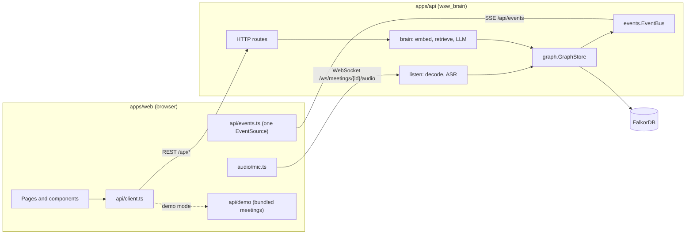

# Architecture

How the parts of On Record fit together, for anyone reading the code for the first time. The [README](../README.md) shows how to run and call each backend module, [DESIGN.md](DESIGN.md) covers the visual design, and [TROUBLESHOOTING.md](TROUBLESHOOTING.md) helps with setup problems.

## The two apps



- **`apps/web`**: the landing page and the app, built with React 19, Vite and TypeScript. All server calls go through `src/api/`.
- **`apps/api`**: the Python 3.12 package `wsw_brain` ("who said what"). Internal names keep the `wsw` prefix from the source project ([UPSTREAM.md](UPSTREAM.md)).
- **FalkorDB**: a graph database that stores meetings, people, decisions, action items and documents. It also provides the full-text and vector search. Run it with `docker compose up -d --wait falkordb`.

| Package | What it holds |
| --- | --- |
| `wsw_brain/contracts.py` | Shared data shapes (`Utterance`, `Insights`, `AskResult`, …) and the `ASR`, `LLM` and `Embedder` interfaces that adapters implement |
| `wsw_brain/config.py` | `Settings`, read from `WSW_*` environment variables and `.env` |
| `wsw_brain/events.py` | The in-process event bus behind the live updates stream |
| `wsw_brain/graph/` | `GraphStore` and every Cypher statement it runs (`cypher.py`) |
| `wsw_brain/listen/` | Audio decoding and resampling, and speech recognition (faster-whisper, Sarvam Saaras) |
| `wsw_brain/brain/` | Text embeddings, hybrid retrieval, and the text model adapters (Ollama, Gemini, OpenAI-compatible, Sarvam, fake) |
| `wsw_brain/documents/` | Document upload, digitising, chunking, search and answers |
| `wsw_brain/app.py` | The HTTP application entrypoint |

In development, Vite serves the web app on port 5173 and proxies `/api` and `/ws` to `WSW_API_URL` (default `http://127.0.0.1:8000`). For an API hosted elsewhere, build the web app with `VITE_API_BASE` set to its origin.

### What is not in the repository yet

The repository is being assembled in feature-sized PRs, so several things the web app calls have no server yet:

- `wsw_brain.app:app` serves only `GET /healthz` and `GET /api/status`.
- `wsw_brain.documents.app:app` serves only `/api/documents/*`. The web app on `main` has no Documents page yet.
- No server provides the meeting routes listed in `apps/web/src/api/client.ts` (`/api/health`, `/api/meetings`, `/api/ask`, …), the `/api/events` stream or the audio WebSocket.
- The listener and the assistant exist only as contracts in `contracts.py`. The listener turns captured audio into speaker-attributed utterances. The assistant answers questions with tool calls and returns an `AskResult`.

As a result, the web app's meeting views always run on the bundled demo data today. The live sections below describe what the client expects from the server.

## Demo mode and live mode

`main.tsx` waits for `resolveMode()` (`src/api/mode.ts`) before the first render. The mode is decided once per page load, in this order:

1. The `?demo=` query parameter.
2. The `VITE_DEMO` build variable.
3. If neither is set, `GET {VITE_API_BASE}/api/health` with a 2.5-second timeout. The app goes live only if the response is JSON with a boolean `ok` field. Any other outcome, such as an error, a timeout or a different shape, selects demo mode.

For steps 1 and 2, `1` or `true` forces demo mode, and `0` or `false` forces live mode.

`api` in `src/api/client.ts` is a `Proxy`, so each call goes to `demoApi` or `realApi` depending on the mode at call time; the two share one `Api` type. `demoApi` serves `src/api/demo/fixtures.json`: two scripted meetings built by `scripts/build_demo_fixtures.py`, with audio in `public/demo/audio/`. Responses are delayed by 140 to 300 ms to feel like a network. Edits, such as ticking off an action item, are kept in memory. Creating a meeting, uploading a recording and asking a spoken question reject with a 503, because they need a server.

## Live updates

The server pushes changes to the browser over **Server-Sent Events (SSE)**, a one-way stream from server to browser. The audio WebSocket is used only to send microphone audio up.

**Server.** `EventBus` (`wsw_brain/events.py`) is an in-process publish/subscribe queue. Writers, such as the graph store and the listener, publish events. The SSE endpoint gives each connected browser its own queue of up to 2000 events. The bus also keeps the last 500 events, so a reconnecting browser can resume with `since_id`. Each event looks like this:

```json
{"id": 42, "type": "utterance.created", "meeting_id": "m1", "ts": 1760000000.5, "data": {}}
```

| Type | `data` | Used by |
| --- | --- | --- |
| `meeting.started`, `meeting.ended` | `MeetingSummary` | Meeting room, meetings, people, sidebar, graph totals |
| `utterance.created` | `Utterance` | Meeting room, meetings, graph |
| `speaker.merged` | `{from, to}` speaker tracks | Meeting room, graph, sidebar |
| `speaker.named` | `{track, name, person_id}` | Meeting room, people, graph, sidebar |
| `insight.created` | `{kind: "decision" \| "action_item" \| "topic", item}` | Meeting room, decisions, commitments, graph, sidebar |
| `action.updated` | `ActionItem` | Meeting room, commitments, people, sidebar |
| `graph.write` | `{utterances, ms, totals}` | Meeting room, graph, graph totals |
| `listener.status` | `{state, lag_s, detail}` | Meeting room |

**Browser.** `hub` (`src/api/events.ts`) is the app's single `EventSource` on `/api/events?since_id=<last id seen>`. It opens on the first subscription and never opens in demo mode. After an error, it reconnects with exponential backoff from 0.5 s to 10 s and resumes from the last id. Components subscribe with `useBusEvents(handler, filter)`.

- **Meeting room.** `useMeetingRoom` loads the meeting once over REST, then turns each event into an action for `roomReducer` (`components/meeting/meetingState.ts`). The reducer is a pure function that merges utterances by sequence number, applies renames and merges, and marks new insights so they can be highlighted. After a reconnect, the hook fetches any utterances it missed with `utterancesAfter(lastSeq)`.
- **Other pages.** These use `useLiveRefresh` (`components/ask/useLiveRefresh.ts`), which refetches the page's data 700 ms after the last relevant event.

**Window events.** Components that are far apart in the component tree also signal each other with `CustomEvent`s on `window`:

| Event | Effect |
| --- | --- |
| `wsw:ask-open` | Open the Ask drawer |
| `wsw:ask` | Open the Ask drawer and ask `detail.question` |
| `wsw:palette-open` | Open the command palette (⌘K) |
| `wsw:refresh` | Refetch `action_items`, `decisions` or `meeting`. The Ask drawer sends it after an answer changes data |
| `wsw:theme` | The light or dark theme changed |

## Audio

The browser has two separate audio pipelines. Both produce 16 kHz mono 16-bit PCM, the format the speech models expect.

### Meeting capture

`src/audio/mic.ts` streams a live meeting to the server. `components/meeting/useCapture.ts` starts and stops it from the meeting room.

1. `getUserMedia` opens the microphone at the device's sample rate.
2. The AudioWorklet in `pcm-worklet.js` filters out content above 7.2 kHz and downsamples to 16 kHz. It emits 100 ms frames of Int16 samples (3200 bytes), each with an RMS level for the meter.
3. Frames are sent as binary messages on `/ws/meetings/{id}/audio`. The server replies with JSON: `{"type": "status", "state": "listening" | "processing", …}` or `{"type": "error", "detail": …}`.
4. Stopping sends `{"type": "stop"}` to end the meeting, or `{"type": "stop", "end": false}` to keep it live. The client then waits up to 1.5 s for buffered audio to drain. If more than 4 MB of audio is waiting to send (about two minutes), the link is treated as down.

Transcribed utterances come back over the SSE stream as `utterance.created`, not over the socket. A recorded file can be sent instead with `POST /api/meetings/upload`, where `pace` is `fast` or `realtime`. On the server, `listen/audio.py` decodes and resamples. `listen/asr.py` (faster-whisper) and `listen/sarvam_asr.py` (Saaras, for Indian languages and code-mixed speech) transcribe.

### Spoken questions

`src/audio/question.ts` records one question for the Ask drawer:

1. The microphone feeds an AudioWorklet tap, with `ScriptProcessor` as a fallback. The audio is mixed to mono, low-pass filtered and resampled to 16 kHz.
2. A clip buffer holds up to 30 s. It also keeps a rolling 0.6 s of audio from before the clip starts, so a clip started by voice detection keeps its first syllable.
3. The clip is encoded as a WAV file and sent to `POST /api/ask/voice`.

`components/ask/useVoiceQuestion.ts` decides when a clip starts and ends. There are three ways to ask:

- **Hold.** Press and hold the talkback button, or Space, for at least 350 ms, then release to send.
- **Click.** Click once to start listening, and press again to send.
- **Hands-free.** The microphone stays open. An energy-based voice detector (`audio/vad.ts`) sends each question when the speaker pauses. While an answer is being read aloud, the detector raises its threshold by 14 dB and learns how loud the answer is at the microphone, so the speakers don't trigger it.

## Asking a question

`components/ask/AskDrawer.tsx` opens on the `/` key, `wsw:ask-open` or `wsw:ask`.

1. A typed question goes to `POST /api/ask` as `{session_id, question, meeting_id?}`. A spoken one goes to `POST /api/ask/voice` as a multipart form with `audio`, `session_id` and optionally `meeting_id`. `meeting_id` limits the search to one meeting. A new question cancels any request still in flight.
2. The server retrieves evidence and asks a text model (see below). It returns an `AskResult` with:
   - `answer`: the answer text.
   - `citations`: the utterances the answer cites (`Hit`: meeting, speaker, times, text, and which search found it).
   - `actions`: steps for the client to run, such as seeking the player to a moment (`seek`), opening a meeting, refreshing a page, or showing a draft.
   - `tool_trace`, `cypher` and `timings`: shown under "Why this answer" (`WhyPanel.tsx`).
   - `transcript`: what was heard, for spoken questions.
3. If speaking is turned on, the drawer reads the answer aloud with the browser's `speechSynthesis` (`speech.ts`). Pressing talkback cuts it off.
4. The conversation is kept in `sessionStorage` (`askStore.ts`) and rebuilt from `GET /api/sessions/{id}` if it is lost. On the server, each turn is a `Turn` node.

The server-side pieces that exist today:

- **`brain/retrieve.py`.** `Retriever` merges full-text, vector, speaker and recency searches with reciprocal-rank fusion.
- **`brain/llm.py`.** The text model adapters, the `get_llm()` provider factory, and `ModelGate`, which limits how many generations run at once against each endpoint.
- **`documents/answer.py`.** The same approach for uploaded documents: it cites passages as `[d:<chunk id>]` and can check them against meetings.

The assistant loop that ties these together is not in the repository yet.

## Graph schema

Everything lives in one FalkorDB graph, named by `WSW_GRAPH` (default `wsw_demo`). Meeting statements are in `graph/cypher.py` and document statements in `documents/store.py`. Values are always passed as query parameters.

### Nodes

| Label | Id | Main properties |
| --- | --- | --- |
| `Meeting` | Chosen by the caller, e.g. `m1` | `title`, `status` (`live` or `ended`), `source` (`mic`, `upload` or `demo`), `started_at`, `ended_at`, `duration_s`, `has_audio`, `summary` |
| `Speaker` | `<meeting>:<track>`, e.g. `m1:S2` | `meeting_id`, `track` (`S2`), `label` (`Speaker 2`), `name`, `color_idx` (0 to 7) |
| `Utterance` | `<meeting>:u<seq, 5 digits>`, e.g. `m1:u00042` | `meeting_id`, `seq`, `speaker` (track), `t_start`, `t_end`, `text`, `confidence`, `embedding` |
| `Decision` | `<meeting>:d-<12-character hash of the text>` | `meeting_id`, `text`, `status` (`active` or `superseded`), `made_at`, `created_at`, `proposed_by_name` |
| `ActionItem` | `<meeting>:a-<12-character hash of the text>` | `meeting_id`, `text`, `status` (`open` or `done`), `due`, `owner_name`, `owner_track`, `owner_said`, `created_at`, `done_at` |
| `Person` | Slug of the name | `name` |
| `Topic`, `Entity` | Slug of the name | `name`; an `Entity` also has `kind` |
| `Turn` | Random hex | `session_id`, `role`, `text`, `at`, `citations`, `n` (position in the session) |
| `Document` | `doc-<filename slug>-<8 hex>` | `title`, `filename`, `language`, `pages`, `parts`, `status`, `summary`, `embedder`, `created_at` |
| `DocChunk` | `<document>:c<seq, 4 digits>` | `doc_id`, `seq`, `page_start`, `page_end`, `heading`, `text`, `embedding` |

`Person`, `Topic` and `Entity` are shared across meetings. Deleting a meeting removes those left with no connections. Every other meeting node carries `meeting_id`.

Decision and action item ids come from a hash of their text, so extracting the same item twice updates it instead of duplicating it.

Code relies on the utterance id format: citations wrap it as `[u:m1:u00042]`, and neighbouring lines are found from it. Changing the format would break both.

### Relationships

```
(Meeting)-[:HAS_SPEAKER]->(Speaker)        (Meeting)-[:HAS_UTTERANCE]->(Utterance)
(Meeting)-[:ABOUT]->(Topic)                (Utterance)-[:SPOKEN_BY]->(Speaker)
(Utterance)-[:NEXT]->(Utterance)           (Utterance)-[:MENTIONS]->(Topic | Entity)
(Speaker)-[:IS]->(Person)                  (Decision)-[:DECIDED_IN]->(Meeting)
(ActionItem)-[:RAISED_IN]->(Meeting)       (Decision | ActionItem)-[:EVIDENCED_BY]->(Utterance)
(Decision)-[:PROPOSED_BY]->(Speaker)       (ActionItem)-[:ASSIGNED_TO]->(Speaker)
(Decision)-[:SUPERSEDES]->(Decision)       (Document)-[:HAS_CHUNK]->(DocChunk)
```

`NEXT` links each utterance to the one after it in the same meeting. A decision that `SUPERSEDES` another sets the older one's `status` to `superseded`. `Turn` nodes have no relationships.

### Indexes

`GraphStore.ensure_schema(dim)` and `DocumentStore` create indexes as follows. Re-running them is safe.

- **Range indexes:** `id` on every label, plus `Utterance.t_start`, the `meeting_id` fields, `Decision.status`, `ActionItem.status`, `Turn.session_id` and `DocChunk.doc_id`.
- **Full-text indexes:** `Utterance.text` and `DocChunk.text`.
- **Vector indexes:** `Utterance.embedding` and `DocChunk.embedding`, using cosine similarity. Their dimension must match the embedder (`WSW_EMBED_DIM`, default 768). Utterances and chunks stored without an embedding are left out of vector search.

### Time units

The time fields use three different units. Check which one a field uses before comparing or formatting it.

| Unit | Fields |
| --- | --- |
| Seconds from the start of the meeting | `Utterance.t_start`, `Utterance.t_end`, `Decision.made_at`, `Meeting.duration_s` |
| Epoch milliseconds | `Meeting.started_at`, `Meeting.ended_at`, `Decision.created_at`, `ActionItem.created_at`, `ActionItem.done_at`, `Turn.at`, `Document.created_at` |
| Epoch seconds, as a float | `ts` on live update events |
