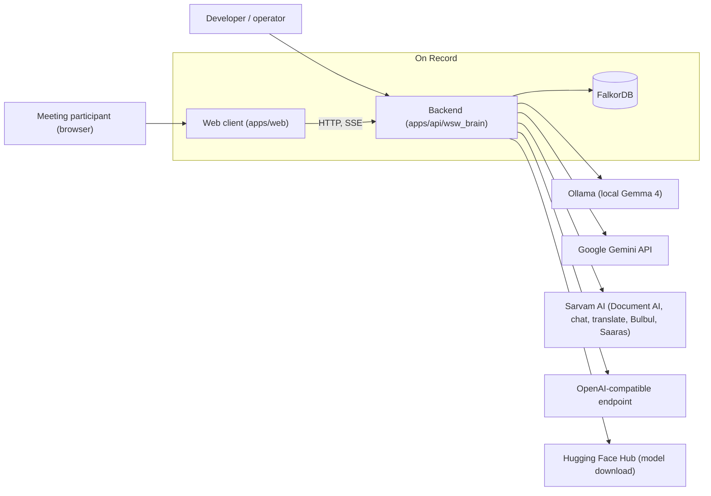
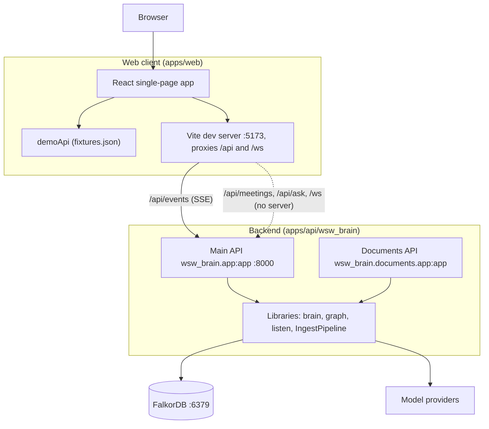
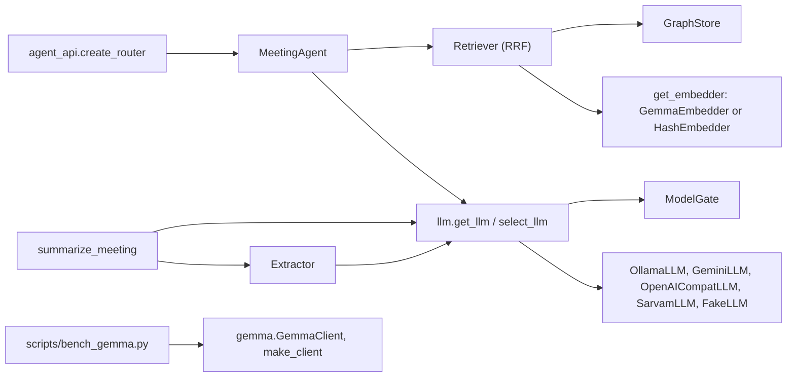
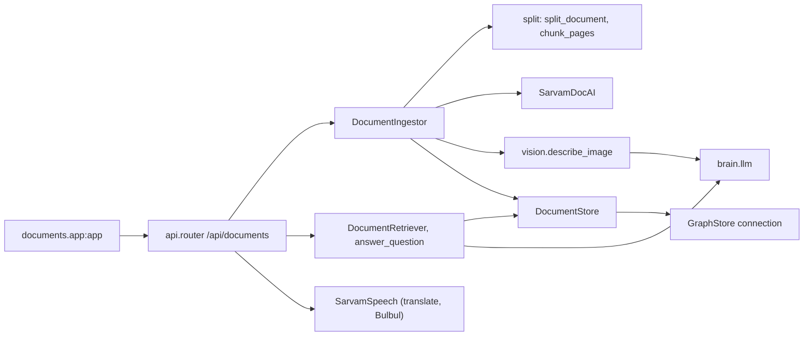
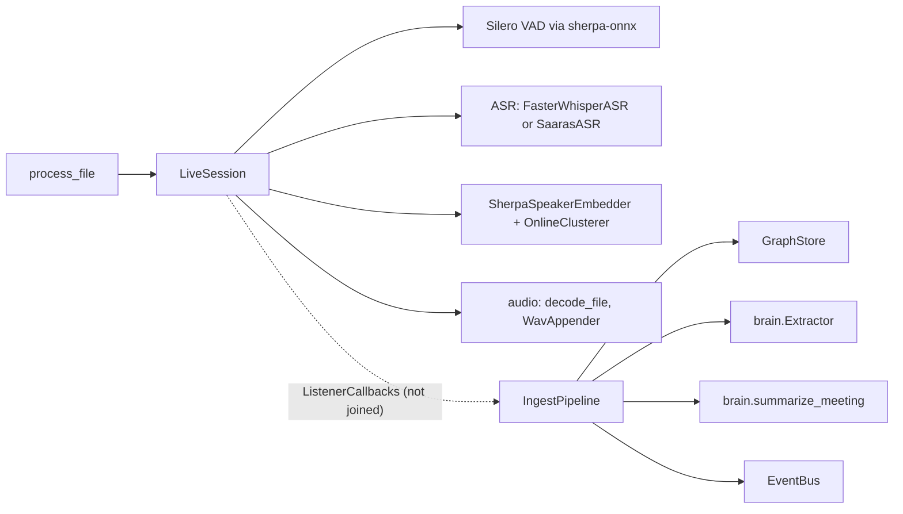
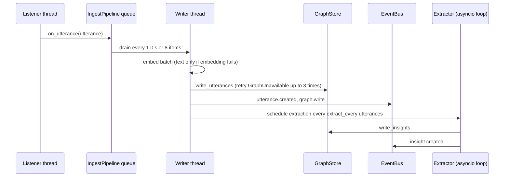

# Architecture description (arc42)

This document describes On Record using the twelve sections of the arc42 template. It is written against commit `8943885`. It does not repeat [ARCHITECTURE.md](../ARCHITECTURE.md), which covers the two apps, demo and live mode, live updates, audio, the Ask sequence and the graph schema; it links to those sections instead. Requirement IDs (FR, NFR) are those of the [software requirements specification](../requirements/SRS.md).

Status labels follow the rest of the documentation: **Implemented**, **Partial** (code exists but is not wired end to end) and **Planned** (only the web client, docs or contracts expect it).

## 1. Introduction and goals

On Record listens to meetings, writes who said what into a graph database, extracts decisions and action items, and answers questions with citations to the exact lines spoken (README.md). It is a monorepo with a Python backend, `apps/api/wsw_brain` (FastAPI, Python 3.12), and a React web client, `apps/web` (see [The two apps](../ARCHITECTURE.md#the-two-apps)).

At `8943885` the web client runs on bundled demo data, because the meeting API it calls is not served by any backend in the repository ([What is not in the repository yet](../ARCHITECTURE.md#what-is-not-in-the-repository-yet)).

### Quality goals

| Priority | Quality goal | What it means here | Requirements |
|---|---|---|---|
| 1 | Grounded answers | Answers and extracted items cite only evidence that was retrieved, and outside material is never treated as instructions | NFR-013, NFR-014 |
| 2 | Local-first privacy and low cost | The whole text path can run on one machine with no paid service | NFR-005, NFR-006, NFR-007 |
| 3 | Graceful degradation | A failed model, embedding or source falls back instead of failing the request | NFR-008, NFR-009, NFR-010, NFR-011, NFR-026 |
| 4 | Bounded resource use | Model calls and audio backlog are capped and queued | NFR-003, NFR-004 |
| 5 | Maintainability | Shared contracts, one module for all Cypher, tests against a real FalkorDB | NFR-022, NFR-024, NFR-025 |

### Stakeholders

| Role | Expectation |
|---|---|
| Developer reading the code | A map of the packages and which parts are wired today |
| Operator running it locally | Which processes to start and which services data is sent to |
| Meeting participant (end user) | Cited answers and a record of decisions and commitments |

User numbers and service levels are not recorded in the repository.

## 2. Constraints

| Constraint | Source |
|---|---|
| Python `>=3.12,<3.14`, dependencies locked with `uv.lock` | apps/api/pyproject.toml:6, apps/api/uv.lock |
| FalkorDB `v4.22.0` in Docker, bound to loopback | docker-compose.yml:4-5 |
| Web client: React 19, Vite, TypeScript | apps/web/package.json:12-32 |
| All Cypher in one module; values travel as `$params` | apps/api/wsw_brain/graph/cypher.py:1-2 |
| Shared shapes defined once in `contracts.py` ("keep them stable") | apps/api/wsw_brain/contracts.py:1 |
| Settings come only from `WSW_*` environment variables and the repo `.env` | apps/api/wsw_brain/config.py:15-20 |
| Sarvam Document AI accepts at most 10 pages per job, so documents are split | apps/api/wsw_brain/documents/split.py:22 |
| Licence Apache-2.0 | apps/api/pyproject.toml:5 |

## 3. Context and scope

The system boundary contains the web client, the two backend apps and the local graph database. Everything else is an external system that the operator chooses through settings ([CONFIGURATION.md](../CONFIGURATION.md)).

*C4 level 1, system context: On Record and the external systems it can call.*

Sources: apps/web/vite.config.ts:11-16; apps/api/wsw_brain/brain/llm.py:856-891; apps/api/wsw_brain/documents/sarvam.py:51; apps/api/wsw_brain/sarvam.py:64; apps/api/wsw_brain/brain/embed.py:24-40; docker-compose.yml:4-5.

| External system | Data sent | Wired at `8943885` |
|---|---|---|
| Ollama | Chat messages | Yes, when `WSW_LLM_PROVIDER` resolves to `ollama` (apps/api/wsw_brain/brain/llm.py:873-874) |
| Google Gemini API | Chat contents, inline images | Yes, through `GeminiLLM` (apps/api/wsw_brain/brain/llm.py:341) |
| Sarvam AI | Document parts, answer text, speech text | Document AI, translation and Bulbul through the documents app (apps/api/wsw_brain/documents/api.py:91-95); Saaras ASR is not wired (apps/api/wsw_brain/listen/sarvam_asr.py:41) |
| OpenAI-compatible endpoint | Chat payload | Only with `WSW_LLM_PROVIDER=openai` (apps/api/wsw_brain/brain/llm.py:869-872) |
| Hugging Face Hub | Nothing from users; model files are downloaded | First call to `get_embedder()` (apps/api/wsw_brain/brain/embed.py:174) |

## 4. Solution strategy

| Goal | Approach | Evidence |
|---|---|---|
| Grounded answers | Hybrid retrieval (full text, vector, speaker, recency) fused with reciprocal-rank fusion, then a prompt that cites `[u:…]` or `[d:…]` ids; ids that were not retrieved are dropped | apps/api/wsw_brain/brain/retrieve.py:29, apps/api/wsw_brain/brain/agent.py:148, apps/api/wsw_brain/documents/answer.py:155-157 |
| One store for meetings and documents | A property graph in FalkorDB holds meetings, speakers, utterances, insights, documents and chunks | apps/api/wsw_brain/graph/store.py:114, apps/api/wsw_brain/documents/store.py:153 |
| Local-first, provider-neutral models | Text models sit behind the `LLM` protocol; `select_llm` picks one from settings and probes local Ollama under `auto` | apps/api/wsw_brain/contracts.py:283, apps/api/wsw_brain/brain/llm.py:856 |
| Degrade, do not fail | Heuristic extraction and summaries, hashing embeddings, per-source retrieval failures tolerated | apps/api/wsw_brain/brain/extract.py:599, apps/api/wsw_brain/brain/summary.py:45, apps/api/wsw_brain/brain/embed.py:140 |
| Live feedback | An in-process event bus with replay, streamed to the browser as Server-Sent Events (SSE) | apps/api/wsw_brain/events.py:50, apps/api/wsw_brain/event_stream.py:45 |
| Build in feature-sized steps | Components are libraries first; HTTP wiring follows in later PRs, and the web client has a demo mode in the meantime | docs/ARCHITECTURE.md:54 |

## 5. Building block view

### 5.1 Level 2: containers

*C4 level 2, containers: the web client, the two FastAPI apps and the database. Dashed edges are routes the client calls that no server provides.*

Sources: apps/web/vite.config.ts:6-16; apps/web/src/api/client.ts:57-110; apps/api/wsw_brain/app.py:14-44; apps/api/wsw_brain/documents/app.py:21-25; apps/api/wsw_brain/cli.py:24-31; docker-compose.yml:5.

| Container | Responsibility | Status |
|---|---|---|
| Web client | Pages for meetings, commitments, decisions, people and the graph; Ask drawer | Implemented on demo data; live mode Planned (apps/web/src/api/mode.ts:3) |
| Main API | `/healthz`, `/api/status`, `/api/capabilities`, `/api/events`; `/api/agent/ask` only when a `MeetingAgent` is injected | Partial: the default `app` has no agent (apps/api/wsw_brain/app.py:19-20, apps/api/wsw_brain/app.py:44) |
| Documents API | `/api/documents/*`: upload, jobs, search, ask, speak | Implemented as a separate app; not mounted in the main API (apps/api/wsw_brain/documents/app.py:1-7) |
| Libraries | Listener, ingest, extraction, retrieval, agent | Partial: see section 11 |
| FalkorDB | Graph, full-text and vector indexes | Implemented (docker-compose.yml:4-13) |

### 5.2 Level 3: `brain` components

*C4 level 3, components of `brain`. `GemmaClient` is a separate client used only by the benchmark script.*

Sources: apps/api/wsw_brain/brain/agent_api.py:36; apps/api/wsw_brain/brain/agent.py:14-27; apps/api/wsw_brain/brain/retrieve.py:74; apps/api/wsw_brain/brain/extract.py:666; apps/api/wsw_brain/brain/summary.py:9-11; apps/api/wsw_brain/brain/llm.py:67, apps/api/wsw_brain/brain/llm.py:856-891; apps/api/wsw_brain/brain/embed.py:43, apps/api/wsw_brain/brain/embed.py:140, apps/api/wsw_brain/brain/embed.py:174; apps/api/wsw_brain/brain/gemma.py:81, apps/api/wsw_brain/brain/gemma.py:307; scripts/bench_gemma.py:27-37.

### 5.3 Level 3: `graph` components

The graph package is small enough for a table.

| Component | Responsibility | Source |
|---|---|---|
| `GraphStore` | The only module that talks to FalkorDB: schema, meetings, utterances, insights, retrieval queries, sessions | apps/api/wsw_brain/graph/store.py:1, apps/api/wsw_brain/graph/store.py:114 |
| `GraphError`, `GraphUnavailable`, `GraphQueryError` | Error types callers map to HTTP 503 or retries | apps/api/wsw_brain/graph/store.py:76-84 |
| `cypher` | Every Cypher statement, label list and index statement | apps/api/wsw_brain/graph/cypher.py:1-2, apps/api/wsw_brain/graph/cypher.py:11 |
| `text` | Ids, slugs, dedupe keys and full-text query sanitising | apps/api/wsw_brain/graph/text.py:30-101 |

The node and relationship model is in [Graph schema](../ARCHITECTURE.md#graph-schema) and the [data model](../design/data-model.md).

### 5.4 Level 3: `documents` components

*C4 level 3, components of `documents`, served by the standalone documents app.*

Sources: apps/api/wsw_brain/documents/api.py:20-31, apps/api/wsw_brain/documents/api.py:91-95; apps/api/wsw_brain/documents/ingest.py:17-21, apps/api/wsw_brain/documents/ingest.py:42; apps/api/wsw_brain/documents/answer.py:15-19, apps/api/wsw_brain/documents/answer.py:60; apps/api/wsw_brain/documents/vision.py:12-13; apps/api/wsw_brain/documents/store.py:153; apps/api/wsw_brain/documents/app.py:21-25.

### 5.5 Level 3: `listen` components and the ingest pipeline

*C4 level 3, components of `listen` and `IngestPipeline`. The dashed edge is the connection no code makes yet.*

Sources: apps/api/wsw_brain/listen/file_pipeline.py:27, apps/api/wsw_brain/listen/file_pipeline.py:81; apps/api/wsw_brain/listen/session.py:101, apps/api/wsw_brain/listen/session.py:665-680; apps/api/wsw_brain/listen/asr.py:14; apps/api/wsw_brain/listen/sarvam_asr.py:41; apps/api/wsw_brain/listen/speakers.py:19, apps/api/wsw_brain/listen/speakers.py:71; apps/api/wsw_brain/contracts.py:79; apps/api/wsw_brain/ingest/pipeline.py:55, apps/api/wsw_brain/ingest/pipeline.py:118-143.

## 6. Runtime view

The typed-question sequence is in [Asking a question](../ARCHITECTURE.md#asking-a-question), and live updates in [Live updates](../ARCHITECTURE.md#live-updates). Further sequence, activity and state diagrams are in [behaviour.md](../design/behaviour.md). The one scenario below is the live ingest path added by PR #75, which those documents describe only in prose. It runs in tests today; no entrypoint constructs `IngestPipeline` (section 11).

*UML sequence diagram: one batch of live utterances through `IngestPipeline`.*

Sources: apps/api/wsw_brain/ingest/pipeline.py:1-10, apps/api/wsw_brain/ingest/pipeline.py:39-40, apps/api/wsw_brain/ingest/pipeline.py:64-65, apps/api/wsw_brain/ingest/pipeline.py:118-143, apps/api/wsw_brain/ingest/pipeline.py:251-276, apps/api/wsw_brain/ingest/pipeline.py:304-339, apps/api/wsw_brain/ingest/pipeline.py:419-447; apps/api/wsw_brain/config.py:79.

## 7. Deployment view

Only local development is described in the repository. Hosting of https://onrecord.pallabdas.me/ is not recorded in the repository. Operational steps are in the [deployment guide](../operations/deployment.md).

| Node | Process | Address | Source |
|---|---|---|---|
| Docker | FalkorDB `v4.22.0`, AOF persistence, named volume | `127.0.0.1:6379`, browser UI `127.0.0.1:3000` | docker-compose.yml:1-13 |
| Python process | `python -m wsw_brain.cli` runs Uvicorn with `wsw_brain.app:app` | default `127.0.0.1:8000` | apps/api/wsw_brain/cli.py:24-31 |
| Python process (optional) | Documents app `wsw_brain.documents.app:app` | operator's choice [unverified] | apps/api/wsw_brain/documents/app.py:21 |
| Node.js | Vite dev server, proxies `/api` and `/ws` to `WSW_API_URL` | `:5173`, target default `http://127.0.0.1:8000` | apps/web/vite.config.ts:6-16 |
| Local model server (optional) | Ollama, started by `scripts/gemma.sh` | `WSW_OLLAMA_URL` | scripts/gemma.sh:1-40 |

## 8. Cross-cutting concepts

| Concept | Description | Source |
|---|---|---|
| Configuration | One `Settings` class reads `WSW_*` variables and `.env`; `settings()` is cached and creates the data directories. Every setting is listed in [CONFIGURATION.md](../CONFIGURATION.md) | apps/api/wsw_brain/config.py:15-20, apps/api/wsw_brain/config.py:88-93 |
| Events and SSE | `EventBus` keeps 500 events for replay and a queue of 2000 per subscriber, dropping new events when a queue is full. `/api/events` sends `id`, `event` and the payload as `data`, with a keep-alive every 15 s | apps/api/wsw_brain/events.py:53-64, apps/api/wsw_brain/events.py:108-109, apps/api/wsw_brain/event_stream.py:16-23 |
| ModelGate | One gate per model endpoint: `WSW_MODEL_SLOTS` (2) calls at once, at most `WSW_MODEL_MAX_WAITING` (6) ordinary waiters, a `WSW_MODEL_QUEUE_WAIT_S` (90 s) wait; `llm_priority` lets important work jump the queue | apps/api/wsw_brain/brain/llm.py:58-157, apps/api/wsw_brain/config.py:51-53 |
| Error handling | Typed errors (`LLMError`, `GraphUnavailable`, `GraphQueryError`, `SarvamError`, `DocumentError`); the documents API maps graph errors to 503 and Sarvam speech errors to 502; ingest failures are published as `listener.status` "error" | apps/api/wsw_brain/brain/llm.py:53, apps/api/wsw_brain/graph/store.py:76-84, apps/api/wsw_brain/documents/api.py:107-111, apps/api/wsw_brain/documents/api.py:272-273, apps/api/wsw_brain/ingest/pipeline.py:363-370 |
| Untrusted content | `UNTRUSTED_NOTE` is appended to every prompt that carries evidence, passages, transcripts or images; citations not retrieved are removed; remote image URLs are refused | apps/api/wsw_brain/brain/llm.py:36-39, apps/api/wsw_brain/brain/agent.py:148-163, apps/api/wsw_brain/brain/llm.py:487-512 |
| Demo and live mode | The web client decides once per page load; `api` is a `Proxy` over `demoApi` and `realApi`. See [Demo mode and live mode](../ARCHITECTURE.md#demo-mode-and-live-mode) | apps/web/src/api/mode.ts:12-31, apps/web/src/api/client.ts:107-110 |
| Fallbacks | Heuristic extraction and summaries, hashing embeddings, text-only utterance writes | apps/api/wsw_brain/brain/extract.py:599, apps/api/wsw_brain/brain/summary.py:45, apps/api/wsw_brain/brain/embed.py:182-186, apps/api/wsw_brain/ingest/pipeline.py:320-339 |

## 9. Architecture decisions

Decisions are recorded as architecture decision records in the [ADR index](../adr/README.md). This section does not repeat them.

## 10. Quality requirements

### Quality tree

| Quality | Requirements |
|---|---|
| Performance | NFR-001, NFR-002, NFR-003, NFR-004 |
| Privacy and cost | NFR-005, NFR-006, NFR-007 |
| Reliability | NFR-008 to NFR-012, NFR-026 |
| Security | NFR-013 to NFR-017, NFR-027 |
| Accessibility | NFR-018 to NFR-021 |
| Maintainability | NFR-022 to NFR-025, NFR-028 |

### Quality scenarios

| ID | Stimulus | Expected response | Requirement | Status |
|---|---|---|---|---|
| QS-1 | The model returns a citation id that was not retrieved | The id is removed from the answer | NFR-014 | Implemented for documents; Partial for the agent, which is not mounted |
| QS-2 | A transcript line says "ignore previous instructions" | The prompt tells the model to treat it as material | NFR-013 | Implemented |
| QS-3 | No API keys are set and Ollama is not running | `auto` falls back to the fake LLM and embeddings to hashing; the web client uses demo data | NFR-007 | Implemented |
| QS-4 | Nine questions arrive at once for one model endpoint | Two run, six wait, the next one gets "the language model is busy" | NFR-003 | Implemented (apps/api/wsw_brain/brain/llm.py:115-116) |
| QS-5 | FalkorDB is briefly unavailable during live ingest | The write is retried up to 3 times, then reported on the bus | NFR-026 | Partial: `IngestPipeline` is not wired |
| QS-6 | The browser's SSE connection drops | It reconnects with `since_id` and the server replays up to 500 events | NFR-012 | Partial: see section 11 |
| QS-7 | A typed question on the demo meeting | Answer within the quoted 5.1 s median ("M1 Max with Gemma 4 E4B") | NFR-001 | Planned: the figure is quoted in apps/web/src/landing/LinerNotes.tsx:20-23, not measured by the repository |

## 11. Risks and technical debt

Each item was re-checked at `8943885` with `git show` and `git grep`.

| ID | Risk or debt | Evidence | Effect |
|---|---|---|---|
| TD-1 | `IngestPipeline` is constructed by no entrypoint, and nothing joins it to a `LiveSession` | apps/api/wsw_brain/ingest/pipeline.py:55; no import in apps/api/wsw_brain/app.py:1-44; apps/api/wsw_brain/ingest/pipeline.py:118-143 | Live meeting capture does not reach the graph |
| TD-2 | No HTTP or WebSocket route feeds the listener; `process_file` has no production caller | apps/api/wsw_brain/listen/file_pipeline.py:27 | The upload and microphone features of the web client have no server |
| TD-3 | The default app has no `MeetingAgent`, and the client posts to `/api/ask`, not `/api/agent/ask` | apps/api/wsw_brain/app.py:44; apps/web/src/api/client.ts:94; apps/api/wsw_brain/brain/agent_api.py:38-40 | Ask works only in demo mode |
| TD-4 | The meeting routes the client calls (`/api/health`, `/api/meetings`, …) are served by no module | apps/web/src/api/client.ts:57-103 | The client always falls back to demo mode |
| TD-5 | The documents router is not mounted in the main app, although `/api/capabilities` lists `"documents"`; the web client has no Documents page | apps/api/wsw_brain/app.py:32; apps/api/wsw_brain/documents/app.py:1-7 | Two processes are needed, and the capability list is misleading |
| TD-6 | SSE frame mismatch: the server sends only the payload as `data`, but the client reads `id` and `type` from the parsed `data` | apps/api/wsw_brain/event_stream.py:20-23; apps/web/src/api/events.ts:92-96 | Live event handlers would not match once live mode is wired |
| TD-7 | Two model clients: `brain/llm.py` (used by the app) and `brain/gemma.py` (PR #76). `make_client` is exported but never called; `GemmaClient` sends the Gemini key in the URL and adds no `UNTRUSTED_NOTE` | apps/api/wsw_brain/brain/__init__.py:11; apps/api/wsw_brain/brain/gemma.py:239, apps/api/wsw_brain/brain/gemma.py:307 | Duplicate behaviour to keep in step; NFR-027 is only Partial |
| TD-8 | `SaarasASR` and `FasterWhisperASR` are constructed only in tests | apps/api/wsw_brain/listen/sarvam_asr.py:41; apps/api/wsw_brain/listen/asr.py:14 | Choice of speech recogniser is not exposed |
| TD-9 | No authentication or rate limiting on any route; the documents app allows CORS from `*` by default | apps/api/wsw_brain/config.py:81; apps/api/wsw_brain/documents/app.py:22-24 | Safe only on loopback (NFR-017 Planned). See the [threat model](../security/threat-model.md) |
| TD-10 | Agent sessions and document jobs live in process memory | apps/api/wsw_brain/brain/agent.py:36; apps/api/wsw_brain/documents/api.py:51 | Lost on restart |
| TD-11 | The web client has no tests, and CI does not type-check or lint it | apps/web/package.json:6-11 | NFR-023 is Partial |

## 12. Glossary

Terms such as utterance, track, speaker merge, RRF (reciprocal-rank fusion), SSE, ModelGate and demo mode are defined in the [glossary](../glossary.md).
