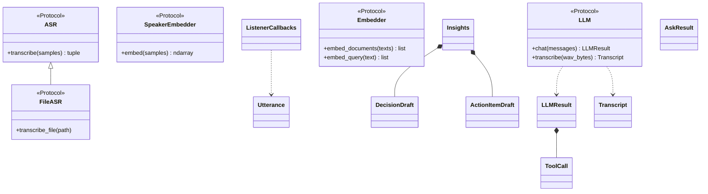
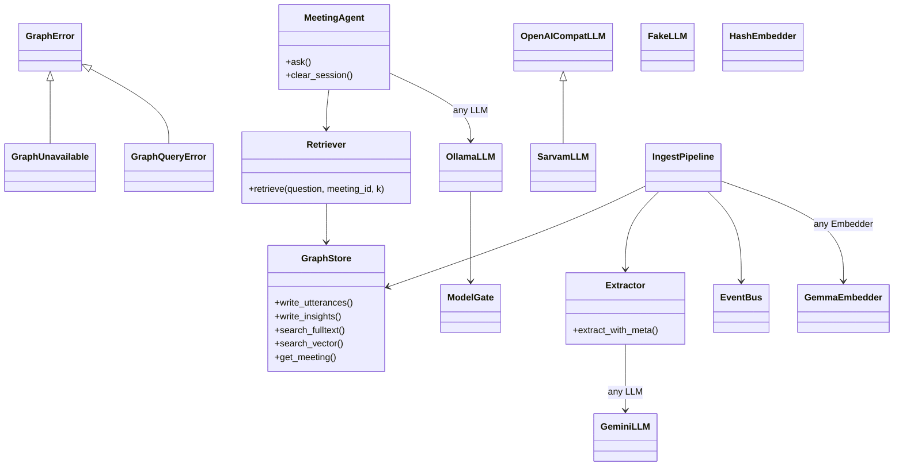
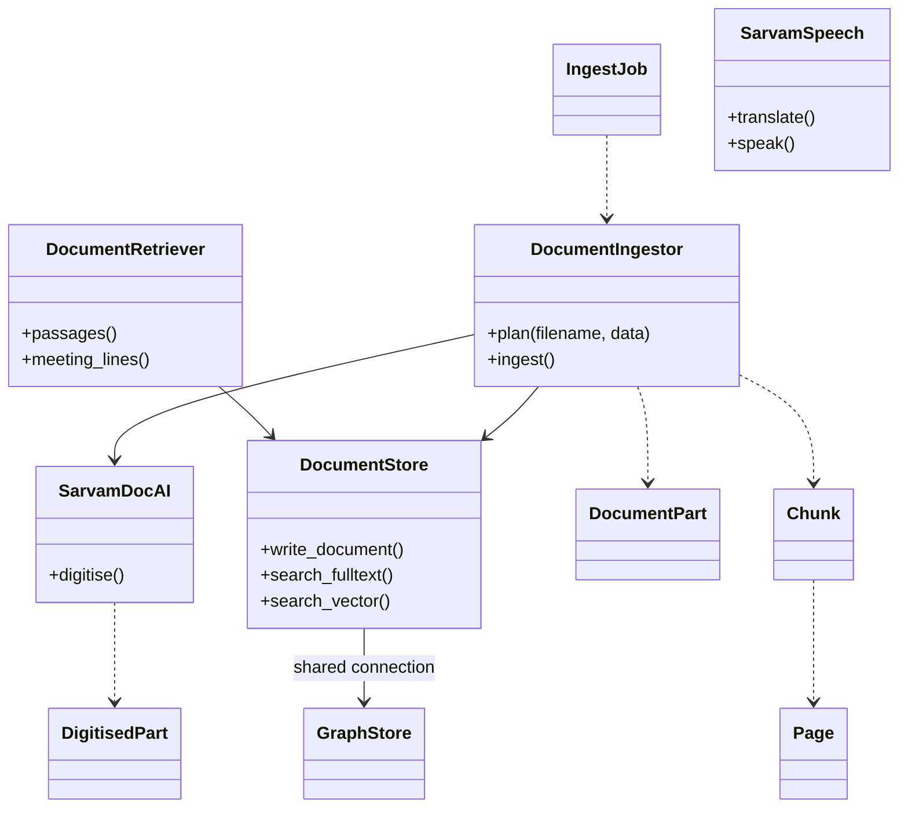
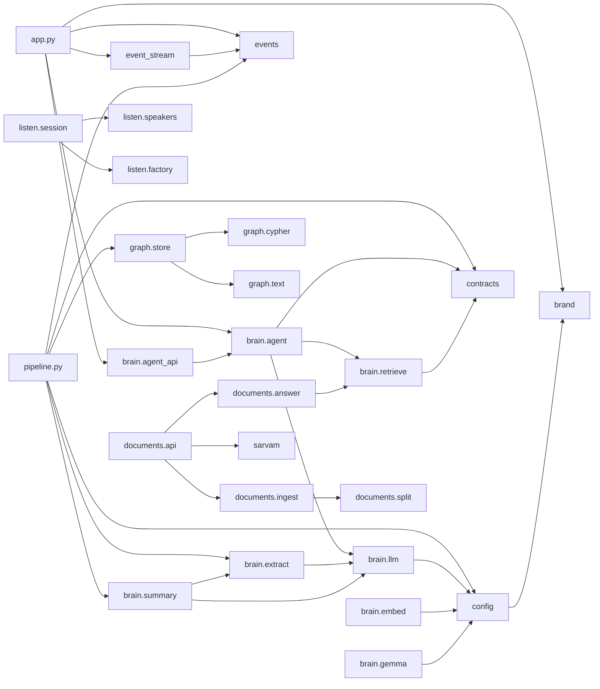

# Software design specification

This document describes the design of the On Record backend (`apps/api/wsw_brain`) and the parts of the web client (`apps/web/src`) that shape it. It is organised by the design viewpoints of IEEE 1016-2009 (the IEEE standard for software design descriptions). It cites code at commit `8943885` and links to the other documents rather than repeating them:

- system overview, Ask sequence and graph schema: [../ARCHITECTURE.md](../ARCHITECTURE.md)
- requirements: [../requirements/SRS.md](../requirements/SRS.md)
- architecture views (arc42): [../architecture/README.md](../architecture/README.md)
- data model: [data-model.md](data-model.md)
- behaviour (sequence and state diagrams): [behaviour.md](behaviour.md)
- HTTP and SSE (Server-Sent Events) interface: [../api/README.md](../api/README.md)
- settings: [../CONFIGURATION.md](../CONFIGURATION.md)

Status labels follow the SRS: Implemented, Partial or Planned.

## Viewpoints at a glance

| Viewpoint | Question it answers | Where |
| --- | --- | --- |
| [Context](#1-context-viewpoint) | What surrounds the system | Links the arc42 context view |
| [Composition](#2-composition-viewpoint) | Which packages make up the backend | Package table |
| [Logical](#3-logical-viewpoint) | Which classes and protocols each package defines | Three class diagrams: contracts, graph and brain, documents |
| [Dependency](#4-dependency-viewpoint) | Which modules import which | Module import flowchart |
| [Information](#5-information-viewpoint) | What is stored | Links the data model |
| [Patterns](#6-patterns-viewpoint) | Which design patterns recur | Protocols and adapters, factories, event bus, demo proxy |
| [Interface](#7-interface-viewpoint) | How parts and clients talk to each other | Python protocols; links the API reference |
| [Interaction and state](#8-interaction-and-state-viewpoints) | How flows run and how items change state | Links the behaviour diagrams |
| [Algorithm](#9-algorithm-viewpoint) | How the non-obvious logic works | Fusion, grounding, extraction windows, chunking and splitting, over-fetch |
| [Resource](#10-resource-viewpoint) | Which limits, timeouts and concurrency caps apply | Limits table |

## 1. Context viewpoint

The system context (users, the browser client, FalkorDB, local and hosted model services, Sarvam) is described in [../architecture/README.md](../architecture/README.md) and in the system overview of [../ARCHITECTURE.md](../ARCHITECTURE.md). This document starts at the package boundary.

## 2. Composition viewpoint

| Package | Responsibility | Entry points | Status |
|---|---|---|---|
| `wsw_brain` (top level) | HTTP app, settings, shared contracts, event bus, SSE route, Sarvam speech client, live ingest pipeline | `create_app` apps/api/wsw_brain/app.py:14; `IngestPipeline` apps/api/wsw_brain/pipeline.py:55 | App Implemented; pipeline Partial (no entrypoint constructs it, apps/api/wsw_brain/app.py:44) |
| `wsw_brain.brain` | Model adapters, embeddings, extraction, summary, hybrid retrieval, grounded Q&A agent | `get_llm` apps/api/wsw_brain/brain/llm.py:891; `MeetingAgent` apps/api/wsw_brain/brain/agent.py:27 | Partial: `MeetingAgent` is never constructed in production code (apps/api/wsw_brain/app.py:44) |
| `wsw_brain.graph` | The only FalkorDB client; all Cypher; id and text helpers | `GraphStore` apps/api/wsw_brain/graph/store.py:114 | Implemented |
| `wsw_brain.listen` | Audio decoding, VAD (voice activity detection), ASR (automatic speech recognition) adapters, speaker clustering, `LiveSession` | `LiveSession` apps/api/wsw_brain/listen/session.py:101; `process_file` apps/api/wsw_brain/listen/pipeline.py:27 | Partial: no HTTP or WebSocket route feeds a session |
| `wsw_brain.documents` | Document upload, splitting, Sarvam Document AI, chunking, storage, retrieval and answers | `router` apps/api/wsw_brain/documents/api.py:31; standalone app apps/api/wsw_brain/documents/app.py:21 | Implemented (served by the standalone documents app) |
| `apps/web/src` | React client with a live mode and a bundled demo mode | `api` proxy apps/web/src/api/client.ts:108 | Implemented |

Sources: inventory of modules at `8943885`; apps/api/wsw_brain/brain/__init__.py:3-25; apps/api/wsw_brain/listen/__init__.py:3-18; apps/api/wsw_brain/documents/__init__.py:3-15.

## 3. Logical viewpoint

Three class diagrams cover the stable contracts, the graph and brain classes, and the documents package. Attributes are omitted where they add nothing.

### 3.1 Contracts

*Logical view: the protocols and data classes in `contracts.py` that every adapter and consumer depends on.*

Sources: apps/api/wsw_brain/contracts.py:34, apps/api/wsw_brain/contracts.py:79, apps/api/wsw_brain/contracts.py:87-114, apps/api/wsw_brain/contracts.py:138, apps/api/wsw_brain/contracts.py:156, apps/api/wsw_brain/contracts.py:221, apps/api/wsw_brain/contracts.py:254-320, apps/api/wsw_brain/contracts.py:329.

### 3.2 Graph and brain

*Logical view: the graph store, the model adapters and the classes that compose them; `OllamaLLM`, `GeminiLLM`, `OpenAICompatLLM` and `FakeLLM` all satisfy the `LLM` protocol, and `GemmaEmbedder` and `HashEmbedder` the `Embedder` protocol.*

Sources: apps/api/wsw_brain/graph/store.py:76-114; apps/api/wsw_brain/brain/retrieve.py:74; apps/api/wsw_brain/brain/agent.py:27; apps/api/wsw_brain/brain/extract.py:666; apps/api/wsw_brain/brain/llm.py:67, apps/api/wsw_brain/brain/llm.py:203, apps/api/wsw_brain/brain/llm.py:341, apps/api/wsw_brain/brain/llm.py:567, apps/api/wsw_brain/brain/llm.py:751, apps/api/wsw_brain/brain/llm.py:796; apps/api/wsw_brain/brain/embed.py:43, apps/api/wsw_brain/brain/embed.py:140; apps/api/wsw_brain/pipeline.py:55-66; apps/api/wsw_brain/events.py:50.

A second Gemma client, `GemmaClient` and `FakeGemmaClient` (apps/api/wsw_brain/brain/gemma.py:81, apps/api/wsw_brain/brain/gemma.py:273), is not in the diagram. It is separate from the `LLM` adapters in apps/api/wsw_brain/brain/llm.py and is constructed only by scripts/bench_gemma.py:27-37 and tests. Its `make_client` factory has no production caller (apps/api/wsw_brain/brain/gemma.py:307).

### 3.3 Documents

*Logical view: the documents package, from upload job to stored chunks and retrieval.*

Sources: apps/api/wsw_brain/documents/ingest.py:42, apps/api/wsw_brain/documents/ingest.py:69, apps/api/wsw_brain/documents/ingest.py:87; apps/api/wsw_brain/documents/sarvam.py:40, apps/api/wsw_brain/documents/sarvam.py:51; apps/api/wsw_brain/documents/store.py:153; apps/api/wsw_brain/documents/answer.py:60; apps/api/wsw_brain/documents/split.py:39-63; apps/api/wsw_brain/documents/api.py:36; apps/api/wsw_brain/sarvam.py:64.

## 4. Dependency viewpoint

*Module dependency view (a UML package dependency diagram drawn as a flowchart): selected internal imports; every adapter also imports `contracts`, which is left out where it would only add edges.*

Sources: apps/api/wsw_brain/app.py:7-11; apps/api/wsw_brain/event_stream.py:13; apps/api/wsw_brain/config.py:12; apps/api/wsw_brain/pipeline.py:26-32; apps/api/wsw_brain/brain/agent.py:14-16; apps/api/wsw_brain/brain/agent_api.py:10; apps/api/wsw_brain/brain/extract.py:11-12; apps/api/wsw_brain/brain/summary.py:9-11; apps/api/wsw_brain/brain/llm.py:29-30; apps/api/wsw_brain/brain/embed.py:14-15; apps/api/wsw_brain/brain/gemma.py:18-19; apps/api/wsw_brain/brain/retrieve.py:12; apps/api/wsw_brain/graph/store.py:41-58; apps/api/wsw_brain/listen/session.py:40-44; apps/api/wsw_brain/documents/api.py:20-28; apps/api/wsw_brain/documents/answer.py:15-19; apps/api/wsw_brain/documents/ingest.py:17-21.

Two properties hold: `contracts.py`, `graph/cypher.py`, `graph/text.py` and `documents/split.py` import nothing from `wsw_brain`, and `app.py` does not import `pipeline.py` or `documents`.

## 5. Information viewpoint

Node labels, relationships, indexes, id formats and time units are in [data-model.md](data-model.md); the graph schema overview is in [../ARCHITECTURE.md](../ARCHITECTURE.md). All Cypher lives in apps/api/wsw_brain/graph/cypher.py, with values passed as `$params` (apps/api/wsw_brain/graph/cypher.py:1-2).

## 6. Patterns viewpoint

| Pattern | Where | Notes |
|---|---|---|
| Protocols and adapters | `ASR`, `FileASR`, `SpeakerEmbedder`, `LLM`, `Embedder` (apps/api/wsw_brain/contracts.py:87-320) | Adapters satisfy a protocol structurally: `FasterWhisperASR` (apps/api/wsw_brain/listen/asr.py:14) and `SaarasASR` (apps/api/wsw_brain/listen/sarvam_asr.py:41) for ASR; five `LLM` adapters in apps/api/wsw_brain/brain/llm.py; two embedders in apps/api/wsw_brain/brain/embed.py. Fakes (`FakeLLM`, `HashEmbedder`) keep tests and offline runs model-free. |
| Factory functions | `select_llm` / `get_llm` (apps/api/wsw_brain/brain/llm.py:856, apps/api/wsw_brain/brain/llm.py:891); `get_embedder` (apps/api/wsw_brain/brain/embed.py:174); `get_speaker_embedder`, `speaker_clusterer` (apps/api/wsw_brain/listen/factory.py:24-29); `make_client` (apps/api/wsw_brain/brain/gemma.py:307) | Callers ask a factory for a protocol instance built from `Settings`; provider choice stays out of consumers. `make_client` is unused in production. |
| Gate (bounded admission) | `ModelGate` (apps/api/wsw_brain/brain/llm.py:67), one per endpoint key (apps/api/wsw_brain/brain/llm.py:157-164) | Limits concurrent model calls; priority work (`llm_priority`, apps/api/wsw_brain/brain/llm.py:58) is served first and never refused. |
| Event bus with replay | `EventBus` singleton `bus` (apps/api/wsw_brain/events.py:50, apps/api/wsw_brain/events.py:134) and `GET /api/events` (apps/api/wsw_brain/event_stream.py:45) | Publishers do not know subscribers; a late subscriber replays recent events. Only `IngestPipeline` publishes, and it is not wired (apps/api/wsw_brain/pipeline.py:157, apps/api/wsw_brain/pipeline.py:304). |
| Single gateway | `GraphStore` is the only FalkorDB client (apps/api/wsw_brain/graph/store.py:1); `DocumentStore` reuses its connection (apps/api/wsw_brain/documents/store.py:153) | Retries and error mapping in one place. |
| Demo proxy (web) | `api` is a JavaScript `Proxy` that routes each call to `demoApi` or `realApi` (apps/web/src/api/client.ts:1-3, apps/web/src/api/client.ts:108-110) | The mode is resolved at start-up (apps/web/src/api/mode.ts:25), so the proxy decides per call. Demo data is bundled (apps/web/src/api/demo/fixtures.json). |

## 7. Interface viewpoint

Internal interfaces are the Python protocols in apps/api/wsw_brain/contracts.py. The module docstring asks that they be kept stable. Their signatures:

| Protocol | Methods | Location |
|---|---|---|
| `ASR` | `transcribe(samples) -> (text, confidence)` | apps/api/wsw_brain/contracts.py:87-92 |
| `FileASR` | extends `ASR` with `transcribe_file(...)` | apps/api/wsw_brain/contracts.py:98-101 |
| `SpeakerEmbedder` | `embed(samples) -> ndarray` | apps/api/wsw_brain/contracts.py:108-114 |
| `LLM` | `async chat(...) -> LLMResult`; `async transcribe(wav_bytes, *, hint) -> Transcript` | apps/api/wsw_brain/contracts.py:283-304 |
| `Embedder` | `embed_documents(texts)`; `embed_query(text)` | apps/api/wsw_brain/contracts.py:310-320 |

External interfaces (REST routes, request and response bodies, SSE event types) are specified in [../api/README.md](../api/README.md).

## 8. Interaction and state viewpoints

Sequence diagrams (Ask, document upload, live ingest) and state machines (ingest job, meeting, speaker track, web mode) are in [behaviour.md](behaviour.md). The Ask sequence is also in [../ARCHITECTURE.md](../ARCHITECTURE.md).

## 9. Algorithm viewpoint

**Reciprocal-rank fusion (RRF).** `rrf_fuse` (apps/api/wsw_brain/brain/retrieve.py:29-65) merges ranked hit lists. Within each list an utterance is counted once, at its first rank; its fused score is the sum over lists of `1 / (RRF_K + rank)` with `RRF_K = 60` (apps/api/wsw_brain/brain/retrieve.py:16). Each fused hit keeps the dict from the list where it ranked best. Ties break on best `(rank, list)` and then on first appearance, and scores are divided by the top score so the best hit is 1.0 (apps/api/wsw_brain/brain/retrieve.py:57-64). `DocumentRetriever` applies the same fusion to document chunks (apps/api/wsw_brain/documents/answer.py:60).

**Retrieval over-fetch.** `Retriever.retrieve` asks each source for `max(k*2, 10)` hits (apps/api/wsw_brain/brain/retrieve.py:97), so an utterance just below the cut in one list can still reach the top `k`. The sources are full-text, vector (filtered by `same_space_hits`), one list per speaker named in the question, and, for questions such as "just now", the most recent utterances newest first (apps/api/wsw_brain/brain/retrieve.py:98-121). In the store, vector KNN (k-nearest-neighbour) search runs before the meeting filter, so a meeting-scoped search fetches `min(max(k*10, 100), 1000)` neighbours and then trims to `k` (apps/api/wsw_brain/graph/store.py:827-841).

**Citation grounding.** The agent asks the model to cite lines as `[u:<id>]` (apps/api/wsw_brain/brain/agent.py:18). `_ground` (apps/api/wsw_brain/brain/agent.py:148-166) removes every citation whose id is not among the retrieved hits, collects the remaining hits once each in order of first citation, and tidies the whitespace left behind. An answer can therefore only cite utterances that retrieval returned.

**Extraction windowing.** Live extraction is scheduled when at least `extract_every` utterances (default 6, apps/api/wsw_brain/config.py:79) have been written since the last extraction, with one scheduled run per meeting at a time (apps/api/wsw_brain/pipeline.py:373-382). `_extract_pending` (apps/api/wsw_brain/pipeline.py:402-425) takes the pending utterances in chunks of `MAX_NEW_PER_CALL = 16` and gives each call `WINDOW = 14` utterances, padding a short chunk with earlier context (apps/api/wsw_brain/pipeline.py:36-37, apps/api/wsw_brain/pipeline.py:415-418). `_MeetingRecords.admit` filters restatements before `write_insights` (apps/api/wsw_brain/pipeline.py:421-422). Partial: the pipeline has no production entrypoint.

**Document splitting into parts of 10 pages.** Sarvam Document AI rejects PDFs and ZIPs over 10 pages (apps/api/wsw_brain/documents/split.py:22). `split_document` validates `max_pages` in 1-10 (apps/api/wsw_brain/documents/split.py:95-98). A PDF that already fits is sent as the original bytes; otherwise `_split_pdf` writes consecutive page ranges into new PDFs named `<stem>.partNN-pA-B.pdf` (apps/api/wsw_brain/documents/split.py:125-140). ZIPs of images are split the same way (apps/api/wsw_brain/documents/split.py:165). Parts are digitised in parallel under a semaphore (apps/api/wsw_brain/documents/ingest.py:108).

**Document chunking.** `chunk_pages` (apps/api/wsw_brain/documents/split.py:225-265) walks pages in order, splits on blank lines and groups paragraphs into passages of at most 1200 characters (minimum 100). A heading line closes the current passage and becomes the heading of the next, so every passage sits under one heading; passages may span a page break and record `page_start` and `page_end`. A paragraph longer than the limit is split at sentence ends, or hard-wrapped at a space (apps/api/wsw_brain/documents/split.py:267-285).

## 10. Resource viewpoint

| Resource | Limit or timeout | Location |
|---|---|---|
| Model concurrency (`ModelGate`) | 2 slots, 6 waiting, 90 s wait; extra ordinary callers rejected as busy | apps/api/wsw_brain/config.py:51-53; apps/api/wsw_brain/brain/llm.py:115-116 |
| Ollama and OpenAI-compatible HTTP | connect 5, read 180, write 60, pool 5 s | apps/api/wsw_brain/brain/llm.py:40 |
| Ollama probe | 2.0 s | apps/api/wsw_brain/brain/llm.py:41 |
| `GemmaClient` HTTP | 120 s total; no `ModelGate` | apps/api/wsw_brain/brain/gemma.py:93 |
| FalkorDB client | connect 3 s, socket 60 s, health check 30 s, 2 retries with backoff | apps/api/wsw_brain/graph/store.py:149-154 |
| FalkorDB server | query timeout 5000 ms default, 20000 ms max; 500 queued queries | docker-compose.yml:8 |
| Full-text scan | 2000 utterances | apps/api/wsw_brain/graph/store.py:70 |
| Search `k` | 1-500 (meetings); 1-200 store, 1-20 route (documents) | apps/api/wsw_brain/graph/store.py:797; apps/api/wsw_brain/documents/store.py:254; apps/api/wsw_brain/documents/api.py:237 |
| Event bus | replay 500 events, queue 2000 per subscriber | apps/api/wsw_brain/events.py:64 |
| SSE | poll 1 s, keep-alive 15 s | apps/api/wsw_brain/event_stream.py:16-17 |
| Ingest writer | flush every 1.0 s or 8 utterances; 3 write attempts on `GraphUnavailable` | apps/api/wsw_brain/pipeline.py:64-65; apps/api/wsw_brain/pipeline.py:39-40 |
| Ingest shutdown | `stop()`/`aclose()` 15 s; `flush()` 60 s | apps/api/wsw_brain/pipeline.py:92; apps/api/wsw_brain/pipeline.py:102; apps/api/wsw_brain/pipeline.py:171 |
| Extraction output | 5 decisions, 8 action items, 8 topics, 10 entities; max_tokens 1800 | apps/api/wsw_brain/brain/extract.py:16-19; apps/api/wsw_brain/brain/extract.py:667-669 |
| Live session | max 8 speakers, max batch 15 s, max queued audio 300 s | apps/api/wsw_brain/listen/session.py:113-126 |
| File pipeline | max file 2 h; 2 concurrent files | apps/api/wsw_brain/listen/pipeline.py:20-22 |
| Document upload | 25 MB, 100 pages, 10 pages per part, 3 parts in parallel | apps/api/wsw_brain/config.py:45-49 |
| Document AI job | poll 2 s, timeout 300 s, 3 attempts on 429/502/503/504 | apps/api/wsw_brain/documents/sarvam.py:59-60; apps/api/wsw_brain/documents/sarvam.py:130-140 |
| Ingest job retention | 3600 s | apps/api/wsw_brain/documents/api.py:32 |
| Image to Gemma | 7 MiB, PNG or JPEG | apps/api/wsw_brain/documents/vision.py:15 |
| Embedding (EmbeddingGemma) | 4 threads, 256 tokens, batch 16, CPU | apps/api/wsw_brain/brain/embed.py:53-55 |
| Web SSE reconnect | `min(10000, 500×2^retry)` ms | apps/web/src/api/events.ts:86 |

Performance figures are not specified here; the only measured numbers in the repository are in apps/web/src/landing/LinerNotes.tsx, measured "on a MacBook (M1 Max) with Gemma 4 E4B and synthetic voices" (apps/web/src/landing/LinerNotes.tsx:106).
