# Behaviour diagrams

This document shows how the main flows of On Record behave at run time, as the code stands at commit `8943885`. It covers sequence diagrams, activity diagrams (drawn as Mermaid flowcharts) and state diagrams. Each diagram has a status note:

- **Implemented**: the flow runs end to end from a route or entrypoint in the repository.
- **Partial**: the code exists but is not wired end to end. The note says what is missing.
- **Planned**: only the web client, docs or contracts expect it.

The structure behind these flows is in the [software design specification](SDS.md) and the [data model](data-model.md). Requirement IDs are in the [SRS](../requirements/SRS.md). The typed meeting Ask sequence is already drawn in [docs/ARCHITECTURE.md, "Asking a question"](../ARCHITECTURE.md#asking-a-question) and is not repeated here.

## Sequence diagrams

### Meeting capture

**Status: Partial.** `LiveSession` and `IngestPipeline` work together in tests, but no entrypoint builds the pipeline and no HTTP or WebSocket route feeds a listener. The web client streams to `/ws/meetings/{id}/audio`, which no server in the repository serves. `MeetingAgent` and the meeting routes (`/api/meetings…`) are also missing.

*Sequence view: audio from a listener becomes utterances, graph writes, bus events and extracted insights, as the classes are wired at `8943885`.*

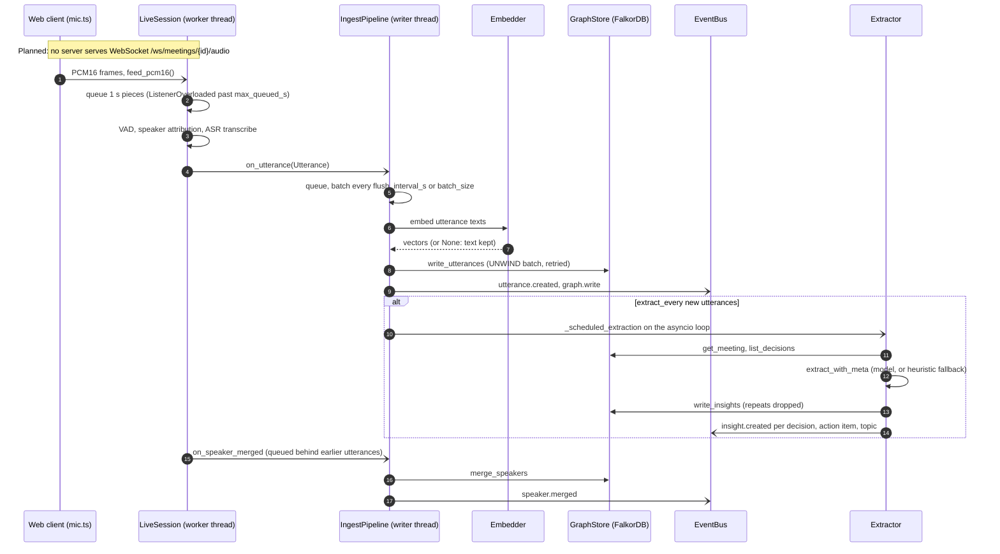

Sources: apps/web/src/api/client.ts:112-118; apps/api/wsw_brain/listen/session.py:196-222, apps/api/wsw_brain/listen/session.py:386-396, apps/api/wsw_brain/listen/session.py:526-547, apps/api/wsw_brain/listen/session.py:562-593; apps/api/wsw_brain/pipeline.py:118-149, apps/api/wsw_brain/pipeline.py:251-318, apps/api/wsw_brain/pipeline.py:328-361, apps/api/wsw_brain/pipeline.py:373-447; apps/api/wsw_brain/brain/extract.py:683-722. `IngestPipeline` is only constructed in apps/api/tests/test_pipeline.py:142; README.md:346 says no HTTP route starts it.

Ending a meeting (`IngestPipeline.end_meeting`) flushes the queue, sets the meeting to `ended`, publishes `meeting.ended`, then runs the final extraction and the summary in the background and publishes a second `meeting.ended` with the summary (apps/api/wsw_brain/pipeline.py:186-240). It has the same status: no route calls it.

### Spoken question

**Status: Planned.** The web client records the question and posts it, but no server route answers `POST /api/ask/voice`. The typed route the agent does have is `POST /api/agent/ask`, and it exists only when a `MeetingAgent` is injected into `create_app`, which the module-level app does not do.

*Sequence view: a spoken question from the Ask drawer; the dashed box marks the steps that have no server route.*

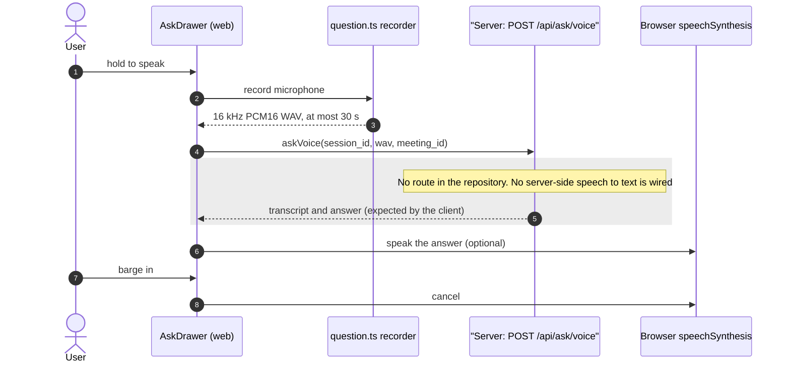

Sources: apps/web/src/audio/question.ts:1-6; apps/web/src/api/client.ts:95-100; apps/web/src/components/ask/AskDrawer.tsx:157-195, apps/web/src/components/ask/AskDrawer.tsx:219-268; apps/web/src/components/ask/speech.ts:1-5; apps/api/wsw_brain/brain/agent_api.py:38-40; apps/api/wsw_brain/app.py:19-20, apps/api/wsw_brain/app.py:44.

### Document ingest

**Status: Implemented** in the documents app (`apps/api/wsw_brain/documents/app.py`). Jobs live in process memory only, so they are lost on restart.

*Sequence view: an upload starts a background ingestion job that the client polls.*

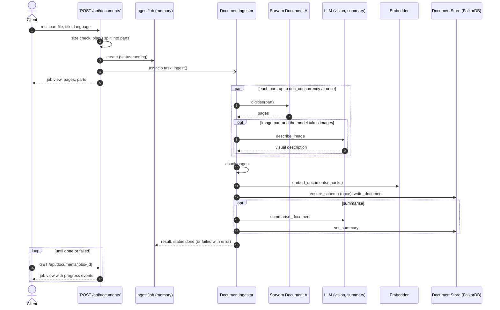

Sources: apps/api/wsw_brain/documents/api.py:35-51, apps/api/wsw_brain/documents/api.py:91-121, apps/api/wsw_brain/documents/api.py:159-215; apps/api/wsw_brain/documents/ingest.py:69-75, apps/api/wsw_brain/documents/ingest.py:87-160, apps/api/wsw_brain/documents/ingest.py:186-190; apps/api/wsw_brain/documents/app.py:25.

### Document Ask with translation and speech

**Status: Implemented** in the documents app. Translation and speech need `SARVAM_API_KEY`; without it those routes return 503. Speech is a separate request, made by the client after the answer arrives.

*Sequence view: a document question answered in English, translated when another Indian language is asked for, then read aloud on request.*

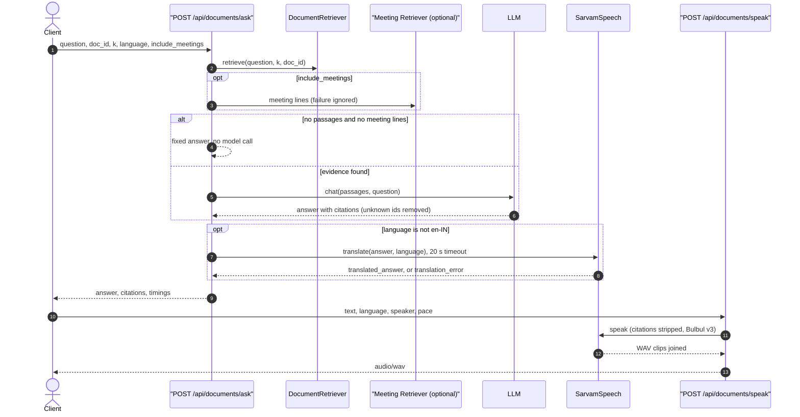

Sources: apps/api/wsw_brain/documents/api.py:56, apps/api/wsw_brain/documents/api.py:91-95, apps/api/wsw_brain/documents/api.py:240-274; apps/api/wsw_brain/documents/answer.py:118-167; apps/api/wsw_brain/sarvam.py:34-38, apps/api/wsw_brain/sarvam.py:78-130, apps/api/wsw_brain/sarvam.py:156-158.

## Activity diagrams

These are UML activity views drawn as Mermaid flowcharts.

### Extraction cycle

**Status: Partial.** The cycle is exercised by tests (apps/api/tests/test_pipeline.py:211), but it only runs inside `IngestPipeline`, which no entrypoint builds.

*Activity view: one scheduled extraction of a meeting, from the trigger to published insights.*

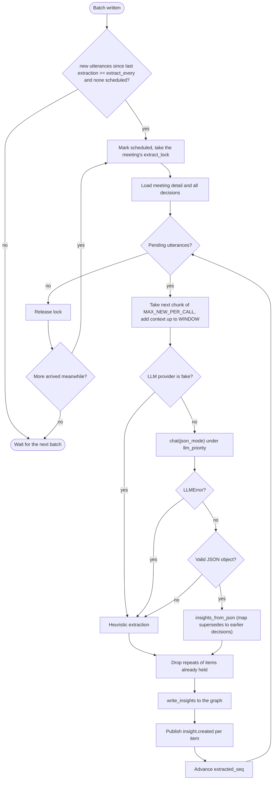

Sources: apps/api/wsw_brain/pipeline.py:373-447, apps/api/wsw_brain/pipeline.py:478-547; apps/api/wsw_brain/brain/extract.py:260, apps/api/wsw_brain/brain/extract.py:348, apps/api/wsw_brain/brain/extract.py:683-757.

### Document ingestion

**Status: Implemented.**

*Activity view: the steps of `DocumentIngestor.ingest` and how a job ends.*

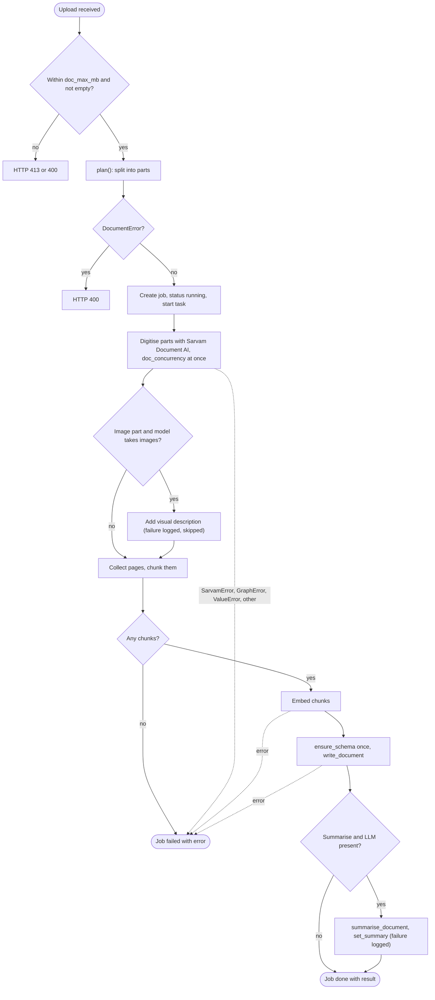

Sources: apps/api/wsw_brain/documents/api.py:114-121, apps/api/wsw_brain/documents/api.py:159-194; apps/api/wsw_brain/documents/ingest.py:87-160, apps/api/wsw_brain/documents/ingest.py:186-191.

### Ask with no-evidence fallback

**Status:** the document path is **Implemented**. The meeting path (`MeetingAgent.ask`) is **Partial**: the code and `POST /api/agent/ask` exist, but the shipped app is created without an agent, so the route is not mounted.

*Activity view: both Ask paths answer without calling the model when retrieval finds nothing.*

```mermaid
flowchart TD
    subgraph Meeting["MeetingAgent.ask (Partial)"]
        M1([Question]) --> M2{Blank?}
        M2 -- yes --> M3[ValueError]
        M2 -- no --> M4["retrieve(question, meeting_id, k)"]
        M4 --> M5{Any hits?}
        M5 -- no --> M6["Fallback: no supporting evidence"]
        M5 -- yes --> M7["chat(evidence, session history)"]
        M7 --> M8[Ground citations against hits]
        M8 --> M9{Answer left?}
        M9 -- no --> M6
        M9 -- yes --> M10[Remember turn in session]
        M10 --> M11([AskResult with citations])
        M6 --> M12([AskResult, no citations])
    end
    subgraph Docs["answer_question (Implemented)"]
        D1([Question]) --> D2[Retrieve passages]
        D2 --> D3{include_meetings?}
        D3 -- yes --> D4["Retrieve meeting lines (errors ignored)"]
        D3 -- no --> D5
        D4 --> D5{Passages or meeting lines?}
        D5 -- no --> D6["Fixed answer: documents do not mention that"]
        D5 -- yes --> D7[chat with passages]
        D7 --> D8[Remove citations to unknown ids]
        D8 --> D9([Answer with citations])
    end
```

Sources: apps/api/wsw_brain/brain/agent.py:19, apps/api/wsw_brain/brain/agent.py:38-94, apps/api/wsw_brain/brain/agent.py:148-163; apps/api/wsw_brain/documents/answer.py:118-167; apps/api/wsw_brain/app.py:19-20, apps/api/wsw_brain/app.py:44.

## State diagrams

### Meeting

**Status: Partial.** The graph store sets both states. Only `IngestPipeline.end_meeting` drives the transition, and nothing calls it outside tests.

*State view: a meeting is created live and becomes ended once; deleting removes it.*

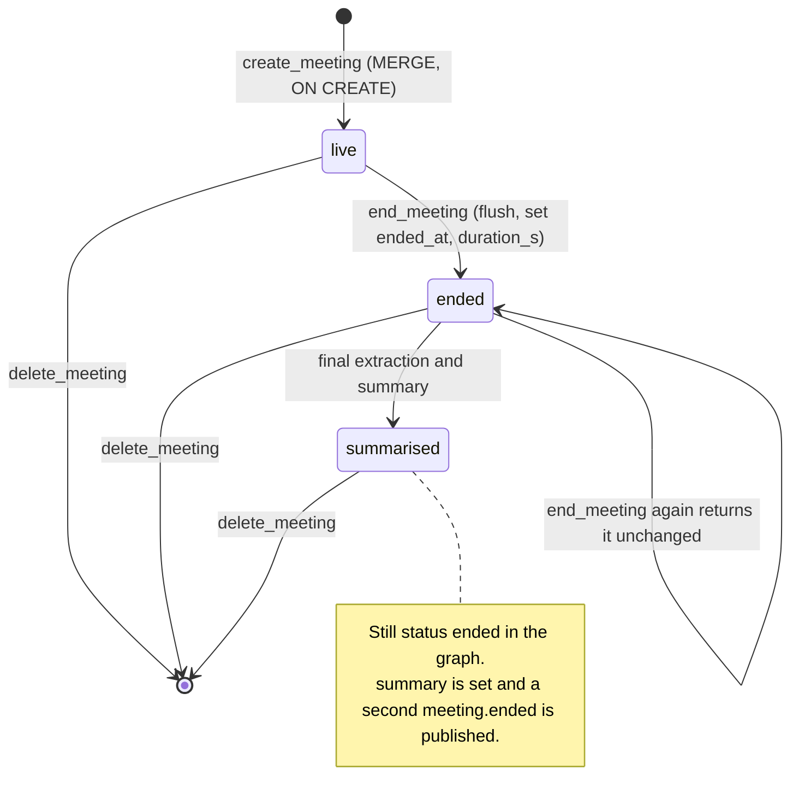

Sources: apps/api/wsw_brain/graph/cypher.py:50-61; apps/api/wsw_brain/graph/store.py:267-335; apps/api/wsw_brain/pipeline.py:186-240.

### Action item

**Status: Partial.** `set_action_item_status` exists in the graph store, but no server route calls it. The web client's `PATCH /api/action-items/{id}` has no server.

*State view: an action item is created open and can move between open and done.*

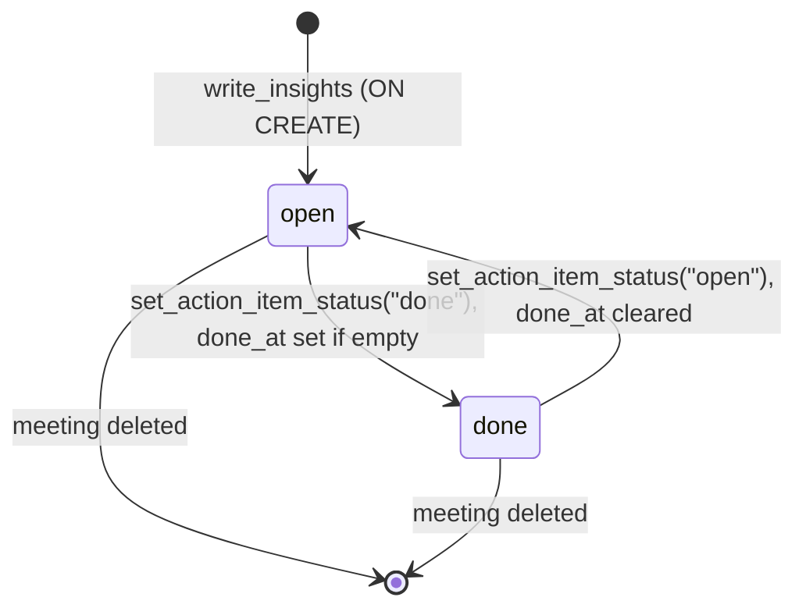

Sources: apps/api/wsw_brain/graph/cypher.py:439-442, apps/api/wsw_brain/graph/cypher.py:544; apps/api/wsw_brain/graph/store.py:63, apps/api/wsw_brain/graph/store.py:693-699; apps/web/src/api/client.ts:79-80.

### Decision

**Status: Partial.** Supersession is written by `write_insights`, which runs only from the unwired extraction cycle.

*State view: a decision is active until a later decision supersedes it, and becomes active again if the superseding meeting is deleted.*

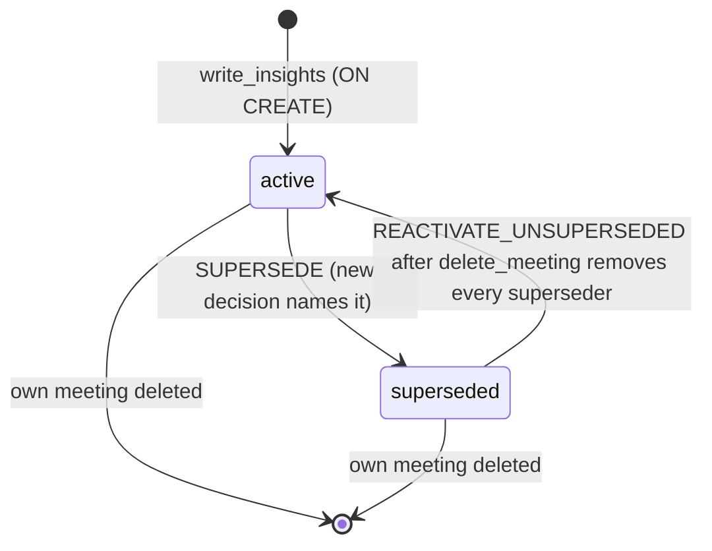

Sources: apps/api/wsw_brain/graph/cypher.py:100-107, apps/api/wsw_brain/graph/cypher.py:429, apps/api/wsw_brain/graph/cypher.py:463-470; apps/api/wsw_brain/graph/store.py:323-335, apps/api/wsw_brain/graph/store.py:578.

### Document ingest job

**Status: Implemented.** Jobs are held in a process-local dictionary.

*State view: a job runs once and ends done or failed; only a finished job can be deleted.*

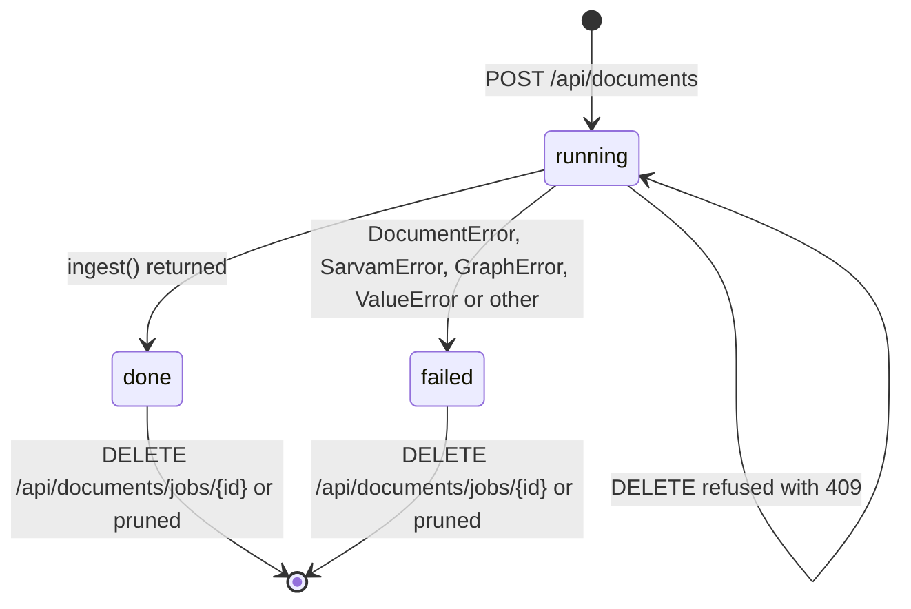

Sources: apps/api/wsw_brain/documents/api.py:35-51, apps/api/wsw_brain/documents/api.py:159-194, apps/api/wsw_brain/documents/api.py:218-226, apps/api/wsw_brain/documents/api.py:290-293.

### ModelGate slot

**Status: Implemented.** Every Ollama, Gemini and OpenAI-compatible call goes through the gate for its endpoint. `GemmaClient` (apps/api/wsw_brain/brain/gemma.py) does not use it.

*State view: one caller's request for a model slot, from asking to release.*

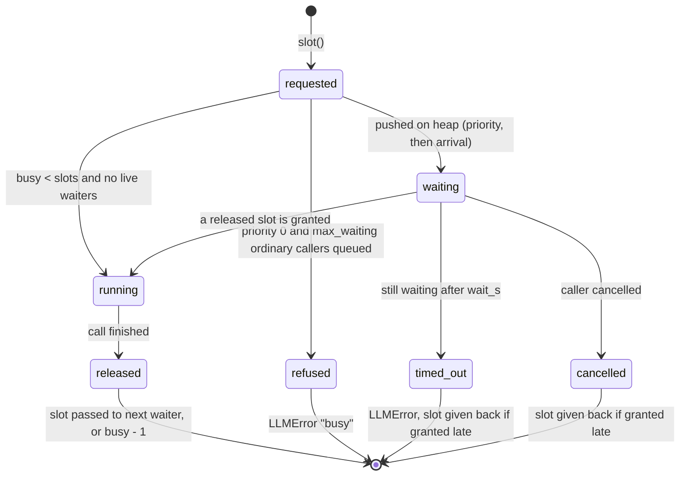

Sources: apps/api/wsw_brain/brain/llm.py:67-150, apps/api/wsw_brain/brain/llm.py:157-164, apps/api/wsw_brain/brain/llm.py:312, apps/api/wsw_brain/brain/llm.py:443, apps/api/wsw_brain/brain/llm.py:626; apps/api/wsw_brain/config.py:51-53.
