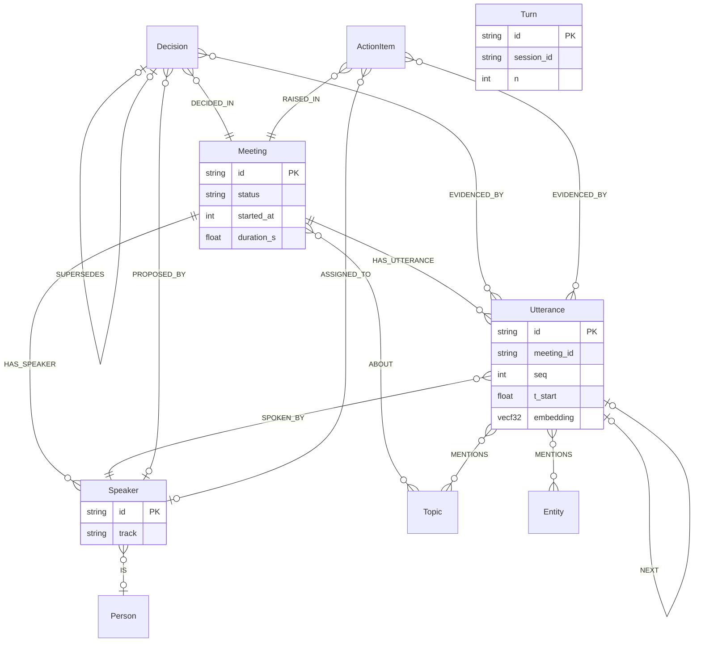
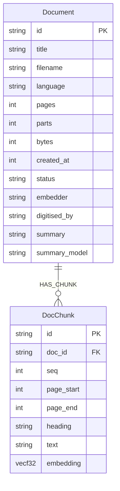
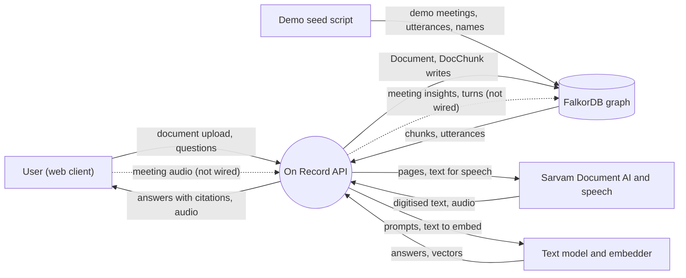
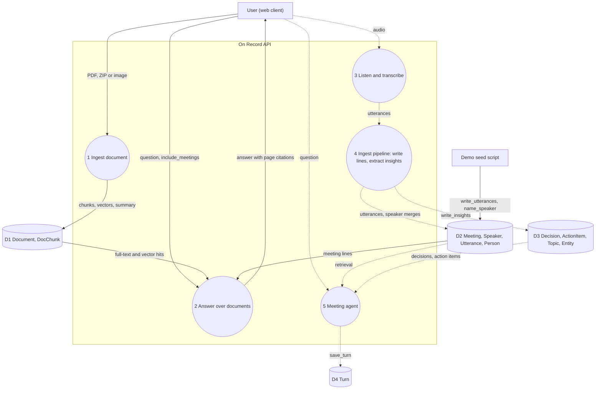

# Data model and data dictionary

This document goes one level below the [graph schema in ARCHITECTURE.md](../ARCHITECTURE.md#graph-schema). That section lists the labels, relationships, indexes and time units in prose. This one adds the property types, the line that writes each property and relationship, and data-flow diagrams (DFDs) that show which writers are reachable at commit `8943885`. Settings such as `WSW_GRAPH` and `WSW_EMBED_DIM` are described in [CONFIGURATION.md](../CONFIGURATION.md).

All line numbers are as they are at commit `8943885`. "Wired" means a route or script reaches the code; see the status column in each table.

## Meeting graph

*Entity-relationship view of the meeting graph in FalkorDB; `Turn` has no relationships.*



Sources: apps/api/wsw_brain/graph/cypher.py:11, apps/api/wsw_brain/graph/cypher.py:146-147, apps/api/wsw_brain/graph/cypher.py:191-193, apps/api/wsw_brain/graph/cypher.py:240-265, apps/api/wsw_brain/graph/cypher.py:426-481, apps/api/wsw_brain/graph/cypher.py:591-596, apps/api/wsw_brain/graph/store.py:548-551, apps/api/wsw_brain/graph/store.py:610-613, apps/api/wsw_brain/graph/store.py:664-665.

## Document store

*Entity-relationship view of the document store, which shares the meeting graph's connection and writer lock.*



Sources: apps/api/wsw_brain/documents/store.py:1-4, apps/api/wsw_brain/documents/store.py:41-61, apps/api/wsw_brain/documents/store.py:209.

`DocChunk.doc_id` is a stored property, not a database constraint; deleting chunks matches on it (apps/api/wsw_brain/documents/store.py:50). Re-ingesting a document deletes its chunks and creates them again (apps/api/wsw_brain/documents/store.py:216-218).

## Data dictionary: nodes

Types are the Python or Cypher values the writer passes. Units are given only where a property is a time or a size.

### Meeting

| Property | Type | Unit | Set by |
| --- | --- | --- | --- |
| `id` | string | | apps/api/wsw_brain/graph/cypher.py:52 |
| `title` | string | | apps/api/wsw_brain/graph/cypher.py:54; `'Untitled meeting'` when first created by an utterance write (apps/api/wsw_brain/graph/cypher.py:242) |
| `status` | `live` or `ended` | | apps/api/wsw_brain/graph/cypher.py:53, apps/api/wsw_brain/graph/cypher.py:59 |
| `source` | `mic`, `upload` or `demo` | | apps/api/wsw_brain/graph/cypher.py:54; allowed values apps/api/wsw_brain/graph/store.py:62 |
| `started_at` | int | epoch ms | apps/api/wsw_brain/graph/cypher.py:54, apps/api/wsw_brain/graph/cypher.py:242 |
| `ended_at` | int | epoch ms | apps/api/wsw_brain/graph/cypher.py:59 |
| `duration_s` | float | seconds | apps/api/wsw_brain/graph/cypher.py:53, apps/api/wsw_brain/graph/cypher.py:59 |
| `has_audio` | bool | | apps/api/wsw_brain/graph/cypher.py:53, apps/api/wsw_brain/graph/cypher.py:65 |
| `summary` | string | | apps/api/wsw_brain/graph/cypher.py:63 |

### Speaker, Person, Utterance

| Label | Property | Type | Unit | Set by |
| --- | --- | --- | --- | --- |
| Speaker | `id`, `meeting_id`, `track`, `label`, `color_idx` | string, string, string, string, int (0 to 7) | | apps/api/wsw_brain/graph/cypher.py:145-146, apps/api/wsw_brain/graph/cypher.py:244-245 |
| Speaker | `name` | string | | apps/api/wsw_brain/graph/cypher.py:186 |
| Person | `id`, `name` | string | | apps/api/wsw_brain/graph/cypher.py:191-192 |
| Utterance | `id`, `meeting_id`, `speaker` (track) | string | | apps/api/wsw_brain/graph/cypher.py:246-247 |
| Utterance | `seq` | int, 0-based | | apps/api/wsw_brain/graph/cypher.py:247; apps/api/wsw_brain/contracts.py:41 |
| Utterance | `t_start`, `t_end` | float | seconds from meeting start | apps/api/wsw_brain/graph/cypher.py:247-248; apps/api/wsw_brain/contracts.py:10 |
| Utterance | `text` | string | | apps/api/wsw_brain/graph/cypher.py:248 |
| Utterance | `confidence` | float in [0, 1] | | apps/api/wsw_brain/graph/cypher.py:248; apps/api/wsw_brain/contracts.py:46 |
| Utterance | `embedding` | `vecf32`, absent when no vector | dimensions | apps/api/wsw_brain/graph/cypher.py:234-235 |

### Decision, ActionItem, Topic, Entity, Turn

| Label | Property | Type | Unit | Set by |
| --- | --- | --- | --- | --- |
| Decision | `id`, `meeting_id`, `text`, `proposed_by_name` | string | | apps/api/wsw_brain/graph/cypher.py:428-430 |
| Decision | `status` | `active` or `superseded` | | apps/api/wsw_brain/graph/cypher.py:429, apps/api/wsw_brain/graph/cypher.py:466 |
| Decision | `made_at` | float | seconds from meeting start | apps/api/wsw_brain/graph/cypher.py:429; earliest cited utterance (apps/api/wsw_brain/graph/store.py:529) |
| Decision | `created_at` | int | epoch ms | apps/api/wsw_brain/graph/cypher.py:430; apps/api/wsw_brain/graph/store.py:1172-1173 |
| ActionItem | `id`, `meeting_id`, `text` | string | | apps/api/wsw_brain/graph/cypher.py:438-439 |
| ActionItem | `status` | `open` or `done` | | apps/api/wsw_brain/graph/cypher.py:439, apps/api/wsw_brain/graph/cypher.py:544 |
| ActionItem | `owner_name`, `owner_track`, `owner_said` | string or null | | apps/api/wsw_brain/graph/cypher.py:440; changed by speaker merges and renames (apps/api/wsw_brain/graph/cypher.py:164-171, apps/api/wsw_brain/graph/cypher.py:197-222) |
| ActionItem | `due` | string or null, free text as spoken | | apps/api/wsw_brain/graph/cypher.py:441-442; apps/api/wsw_brain/contracts.py:163 |
| ActionItem | `created_at`, `done_at` | int | epoch ms | apps/api/wsw_brain/graph/cypher.py:439, apps/api/wsw_brain/graph/cypher.py:544 |
| Topic | `id`, `name` | string | | apps/api/wsw_brain/graph/cypher.py:452-453 |
| Entity | `id`, `name`, `kind` | string; `kind` is `product`, `customer`, `vendor`, `org` or `other` | | apps/api/wsw_brain/graph/cypher.py:459-460; apps/api/wsw_brain/graph/store.py:64, apps/api/wsw_brain/graph/store.py:648-649 |
| Turn | `id`, `session_id`, `role`, `text` | string | | apps/api/wsw_brain/graph/cypher.py:594-595 |
| Turn | `at` | int | epoch ms | apps/api/wsw_brain/graph/cypher.py:595; apps/api/wsw_brain/graph/store.py:893-895 |
| Turn | `citations` | list of strings | | apps/api/wsw_brain/graph/cypher.py:596; apps/api/wsw_brain/graph/store.py:895 |
| Turn | `n` | int, position in the session | | apps/api/wsw_brain/graph/cypher.py:592-596 |

### Document, DocChunk

| Label | Property | Type | Unit | Set by |
| --- | --- | --- | --- | --- |
| Document | `id`, `title`, `filename`, `language`, `status`, `embedder`, `digitised_by` | string | | apps/api/wsw_brain/documents/store.py:42-45; `title` falls back to the filename (apps/api/wsw_brain/documents/store.py:211) |
| Document | `pages`, `parts` | int | | apps/api/wsw_brain/documents/store.py:43, apps/api/wsw_brain/documents/store.py:212 |
| Document | `bytes` | int | bytes | apps/api/wsw_brain/documents/store.py:44, apps/api/wsw_brain/documents/store.py:213 |
| Document | `created_at` | int | epoch ms | apps/api/wsw_brain/documents/store.py:213 |
| Document | `summary`, `summary_model` | string | | apps/api/wsw_brain/documents/store.py:48 |
| DocChunk | `id`, `doc_id`, `heading`, `text` | string | | apps/api/wsw_brain/documents/store.py:55-56, apps/api/wsw_brain/documents/store.py:198-203 |
| DocChunk | `seq`, `page_start`, `page_end` | int | page numbers | apps/api/wsw_brain/documents/store.py:55, apps/api/wsw_brain/documents/store.py:200-202 |
| DocChunk | `embedding` | `vecf32`, absent when no finite vector | dimensions | apps/api/wsw_brain/documents/store.py:57, apps/api/wsw_brain/documents/store.py:221-225 |

## Data dictionary: relationships

| Type | From → to | Meaning | Written by |
| --- | --- | --- | --- |
| `HAS_SPEAKER` | Meeting → Speaker | The track took part in the meeting | apps/api/wsw_brain/graph/cypher.py:147, apps/api/wsw_brain/graph/cypher.py:249 |
| `HAS_UTTERANCE` | Meeting → Utterance | The line belongs to the meeting | apps/api/wsw_brain/graph/cypher.py:250 |
| `SPOKEN_BY` | Utterance → Speaker | Speaker attribution; a stale edge is removed on rewrite | apps/api/wsw_brain/graph/cypher.py:251-255; moved on merge apps/api/wsw_brain/graph/cypher.py:155-157 |
| `NEXT` | Utterance → Utterance | The following line in the same meeting | apps/api/wsw_brain/graph/cypher.py:259-265 |
| `IS` | Speaker → Person | The track has been given a name | apps/api/wsw_brain/graph/cypher.py:188-193 |
| `DECIDED_IN` | Decision → Meeting | Where the decision was made | apps/api/wsw_brain/graph/cypher.py:433 |
| `RAISED_IN` | ActionItem → Meeting | Where the action item was raised | apps/api/wsw_brain/graph/cypher.py:445 |
| `ABOUT` | Meeting → Topic | The meeting covered the topic | apps/api/wsw_brain/graph/cypher.py:454 |
| `SUPERSEDES` | Decision → Decision | The newer decision replaces the older; the older becomes `superseded` | apps/api/wsw_brain/graph/cypher.py:463-470 |
| `EVIDENCED_BY` | Decision or ActionItem → Utterance | The lines the extractor cited | apps/api/wsw_brain/graph/store.py:548, apps/api/wsw_brain/graph/store.py:610 |
| `PROPOSED_BY` | Decision → Speaker | Who proposed it | apps/api/wsw_brain/graph/store.py:551; moved on merge apps/api/wsw_brain/graph/cypher.py:174-180 |
| `ASSIGNED_TO` | ActionItem → Speaker | The owner's track | apps/api/wsw_brain/graph/store.py:613, apps/api/wsw_brain/graph/cypher.py:222 |
| `MENTIONS` | Utterance → Topic or Entity | The line names the topic or entity (matched by slug) | apps/api/wsw_brain/graph/store.py:653-665 |
| `HAS_CHUNK` | Document → DocChunk | The chunk is part of the document | apps/api/wsw_brain/documents/store.py:60 |

All relationship writes use `MERGE` except `HAS_CHUNK`, which uses `CREATE` after the old chunks are deleted (apps/api/wsw_brain/documents/store.py:50-60). `cq.link` skips pairs whose endpoints do not exist (apps/api/wsw_brain/graph/cypher.py:473-481).

## Indexes

| Kind | Label and property | Created by |
| --- | --- | --- |
| Range | `id` on all nine labels in `LABELS` | apps/api/wsw_brain/graph/cypher.py:11, apps/api/wsw_brain/graph/cypher.py:15 |
| Range | `Utterance.t_start`, `Utterance.meeting_id`, `Speaker.meeting_id`, `Decision.meeting_id`, `Decision.status`, `ActionItem.meeting_id`, `ActionItem.status`, `Turn.session_id` | apps/api/wsw_brain/graph/cypher.py:16-23 |
| Full-text | `Utterance.text` | apps/api/wsw_brain/graph/cypher.py:30 |
| Vector, cosine | `Utterance.embedding` | apps/api/wsw_brain/graph/cypher.py:33-37 |
| Range | `Document.id`, `DocChunk.id`, `DocChunk.doc_id` | apps/api/wsw_brain/documents/store.py:27-29 |
| Full-text | `DocChunk.text` | apps/api/wsw_brain/documents/store.py:30 |
| Vector, cosine | `DocChunk.embedding` | apps/api/wsw_brain/documents/store.py:34-38 |

The vector dimension is the embedder's `dim`, passed to `ensure_schema`: `GraphStore.ensure_schema(embedder.dim)` from the seed script (scripts/seed_demo_meetings.py:26) and `DocumentStore.ensure_schema(self.embedder.dim)` during ingestion (apps/api/wsw_brain/documents/ingest.py:133). The embedder sets `dim` to the smaller of `WSW_EMBED_DIM` (default 768, apps/api/wsw_brain/config.py:60) and the model's native size (apps/api/wsw_brain/brain/embed.py:104); the hashing fallback uses `WSW_EMBED_DIM` directly (apps/api/wsw_brain/brain/embed.py:186). If an `Utterance.embedding` index already exists with another dimension, `GraphStore.ensure_schema` raises `GraphError` (apps/api/wsw_brain/graph/store.py:219-226). `DocumentStore` has no such check, but rejects a chunk vector of the wrong length (apps/api/wsw_brain/documents/store.py:221-224).

## Id formats

| Node | Format | Example | Source |
| --- | --- | --- | --- |
| Meeting | Chosen by the caller | `m1` | apps/api/wsw_brain/graph/cypher.py:52 |
| Speaker | `<meeting_id>:<track>`, track `S1`, `S2`, … | `m1:S2` | apps/api/wsw_brain/graph/text.py:82-83; apps/api/wsw_brain/contracts.py:42 |
| Utterance | `<meeting_id>:u<seq, 5 digits>` | `m1:u00042` | apps/api/wsw_brain/contracts.py:66-70 |
| Decision | `<meeting_id>:d-<short_hash(normalised text)>` | | apps/api/wsw_brain/graph/store.py:524; apps/api/wsw_brain/graph/text.py:45-46 |
| ActionItem | `<meeting_id>:a-<short_hash(normalised text)>` | | apps/api/wsw_brain/graph/store.py:593 |
| Topic, Entity | `slug(name)` | | apps/api/wsw_brain/graph/store.py:630, apps/api/wsw_brain/graph/store.py:645 |
| Person | `slug(name)`, or `p-<hash>` when no slug remains | | apps/api/wsw_brain/graph/text.py:40-42 |
| Turn | `uuid4().hex` | | apps/api/wsw_brain/graph/store.py:894 |
| Document | `doc-<slug(filename, 24)>-<8 hex>` | | apps/api/wsw_brain/documents/ingest.py:38-39 |
| DocChunk | `<doc_id>:c<seq, 4 digits>` | | apps/api/wsw_brain/documents/store.py:198 |

## Time units

| Unit | Fields | Source |
| --- | --- | --- |
| Seconds from meeting start (float) | `Utterance.t_start`, `Utterance.t_end`, `Decision.made_at`, `Meeting.duration_s` | apps/api/wsw_brain/contracts.py:10 |
| Epoch milliseconds (int) | `Meeting.started_at`, `Meeting.ended_at`, `Decision.created_at`, `ActionItem.created_at`, `ActionItem.done_at`, `Turn.at`, `Document.created_at` | apps/api/wsw_brain/contracts.py:11; apps/api/wsw_brain/graph/store.py:1172-1173; apps/api/wsw_brain/documents/store.py:213 |
| Epoch seconds (float) | event `ts` only, not stored in the graph | apps/api/wsw_brain/contracts.py:11 |

## Inspecting the graph

With FalkorDB running, its browser is at <http://localhost:3000> (port published in `docker-compose.yml:5`). Select the graph named by `WSW_GRAPH`, `wsw_demo` by default (`apps/api/wsw_brain/config.py:24`). To count what it holds, run the statement that `GraphStore.stats()` sends (`apps/api/wsw_brain/graph/cypher.py:43-46`, `apps/api/wsw_brain/graph/store.py:784-787`), shown here as the code builds it:

```cypher
MATCH (n:Meeting) RETURN 'Meeting' AS label, count(n) AS n
UNION ALL
MATCH (n:Speaker) RETURN 'Speaker' AS label, count(n) AS n
UNION ALL
MATCH (n:Person) RETURN 'Person' AS label, count(n) AS n
UNION ALL
MATCH (n:Utterance) RETURN 'Utterance' AS label, count(n) AS n
UNION ALL
MATCH (n:Topic) RETURN 'Topic' AS label, count(n) AS n
UNION ALL
MATCH (n:Decision) RETURN 'Decision' AS label, count(n) AS n
UNION ALL
MATCH (n:ActionItem) RETURN 'ActionItem' AS label, count(n) AS n
UNION ALL
MATCH (n:Entity) RETURN 'Entity' AS label, count(n) AS n
UNION ALL
MATCH (n:Turn) RETURN 'Turn' AS label, count(n) AS n
UNION ALL
MATCH ()-[r]->() RETURN 'relationships' AS label, count(r) AS n
```

It covers the meeting labels in `LABELS` (`apps/api/wsw_brain/graph/cypher.py:11`); `Document` and `DocChunk` nodes are not counted, though the relationships total includes `HAS_CHUNK` edges.

## Data flow

Solid arrows are flows that a route or script reaches at `8943885`. Dashed arrows are flows whose code exists but which nothing in production calls: `IngestPipeline` is constructed only in a test, `MeetingAgent` is never constructed, and the main app does not mount the documents router (see [What is not in the repository yet](../ARCHITECTURE.md#what-is-not-in-the-repository-yet)).

*DFD level 0: On Record as one process with its external entities and the one data store.*



Sources: apps/api/wsw_brain/documents/app.py:21-25, apps/api/wsw_brain/routes/documents.py:159-287, apps/api/wsw_brain/documents/ingest.py:133-157, scripts/seed_demo_meetings.py:22-42, apps/api/wsw_brain/app.py:44, apps/api/wsw_brain/ingest/pipeline.py:209-447.

*DFD level 1: the processes inside the API and which of them read or write each part of the graph.*



Sources: apps/api/wsw_brain/routes/documents.py:159-194, apps/api/wsw_brain/routes/documents.py:240-262, apps/api/wsw_brain/documents/ingest.py:87-157, apps/api/wsw_brain/documents/answer.py:60-118, apps/api/wsw_brain/listen/file_pipeline.py:27-81, apps/api/wsw_brain/ingest/pipeline.py:118-143, apps/api/wsw_brain/ingest/pipeline.py:334-423, apps/api/wsw_brain/graph/store.py:461, apps/api/wsw_brain/graph/store.py:889-896, scripts/seed_demo_meetings.py:26-42.

Process 1 and 2 run only under the standalone documents app (apps/api/wsw_brain/documents/app.py:25); the main app lists `documents` as a feature but does not serve `/api/documents` (apps/api/wsw_brain/app.py:32). Process 2 reads meeting lines through the shared retriever when `include_meetings` is set (apps/api/wsw_brain/documents/answer.py:93). Because process 4 is not wired, the only meeting data in a running graph is what the seed script writes: meetings, speakers, names, utterances and summaries, without decisions or action items (scripts/seed_demo_meetings.py:6).
