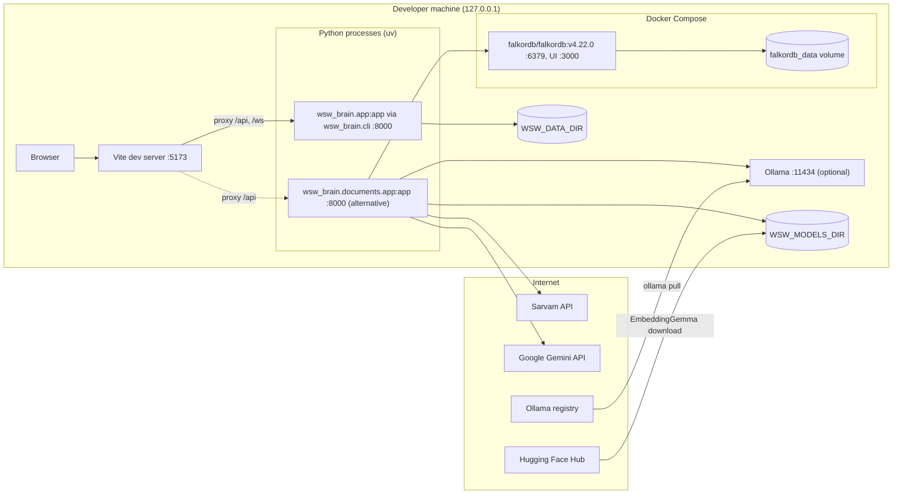

# Deployment and operations

This page describes how On Record runs on a developer machine at commit `8943885`: which processes exist, which ports they use, where models come from and where logs go. Settings are described once, in [CONFIGURATION.md](../CONFIGURATION.md). Fixes for common start-up problems are in [the troubleshooting guide](../guides/troubleshooting.md). The security view of the same topology is in [the threat model](../security/threat-model.md).

## Local development topology

Everything binds to the loopback interface by default. The API command-line launcher listens on `127.0.0.1` (apps/api/wsw_brain/cli.py:24), and Docker Compose publishes FalkorDB on `127.0.0.1` only (docker-compose.yml:5). The only processes that reach the internet are the model clients and the model downloads.

*Deployment view (UML deployment diagram drawn as a flowchart): the processes on one developer machine, the ports they use and the outside services they call. The dashed proxy line is the alternative where the documents app takes port 8000 instead of the main API.*

Sources: docker-compose.yml:3-16, apps/web/vite.config.ts:6-16, apps/api/wsw_brain/cli.py:24-31, apps/api/wsw_brain/documents/app.py:1-25, apps/api/wsw_brain/config.py:25-26, apps/api/wsw_brain/config.py:88-93, apps/api/wsw_brain/brain/embed.py:24-40, scripts/gemma.sh:32-35, .env.example:19.

The main API on `main` does not mount the documents router, and the documents app does not serve the status or event routes ([ARCHITECTURE.md](../ARCHITECTURE.md), "What is not in the repository yet"). Both default to port 8000, so a developer runs one of them on 8000, or moves one with `--port` and points the dev proxy at it with `WSW_API_URL` (apps/web/vite.config.ts:6).

## Docker Compose service

`docker-compose.yml` defines one service.

| Item | Value | Source |
|---|---|---|
| Service | `falkordb` | docker-compose.yml:3 |
| Image | `falkordb/falkordb:v4.22.0` | docker-compose.yml:4 |
| Ports | `127.0.0.1:6379` (Redis protocol, used by `WSW_FALKORDB_URL`) and `127.0.0.1:3000` (FalkorDB browser UI) | docker-compose.yml:5; .env.example:7 |
| Persistence | Append-only file, `appendfsync everysec` | docker-compose.yml:7 |
| Query limits | `TIMEOUT_DEFAULT 5000 TIMEOUT_MAX 20000 MAX_QUEUED_QUERIES 500 RESULTSET_SIZE 10000` | docker-compose.yml:8 |
| Volume | named volume `falkordb_data` at `/var/lib/falkordb/data` | docker-compose.yml:9, docker-compose.yml:15-16 |
| Health check | `redis-cli ping` every 5 s, 20 retries | docker-compose.yml:10-13 |

Start it with `docker compose up -d --wait falkordb` (README.md:102). Port clashes, Colima and resetting the volume are covered in [the troubleshooting guide](../guides/troubleshooting.md#docker-and-the-graph-database).

## Processes to run

| Process | Command | Port | Notes |
|---|---|---|---|
| Python dependencies | `uv sync --project apps/api --frozen` | none | README.md:84 |
| Web dev server | `cd apps/web && npm run dev` | 5173 | Proxies `/api` and `/ws` to `WSW_API_URL`, default `http://127.0.0.1:8000` (apps/web/vite.config.ts:6-16; README.md:73) |
| Main API | `uv run --project apps/api python -m wsw_brain.cli` | 8000 | Options `--host` (default `127.0.0.1`), `--port` (default 8000), `--reload` (apps/api/wsw_brain/cli.py:24-26); runs `wsw_brain.app:app` under Uvicorn (apps/api/wsw_brain/cli.py:31; README.md:153) |
| Documents app | `uv run --project apps/api uvicorn wsw_brain.documents.app:app --port 8000` | 8000 | Serves only `/api/documents`; adds CORS headers from `WSW_CORS_ORIGINS` (apps/api/wsw_brain/documents/app.py:1-7, apps/api/wsw_brain/documents/app.py:22-25; README.md:275) |
| Ollama (optional) | `./scripts/gemma.sh` | 11434 | Starts Ollama, waits up to 30 s for `/api/tags`, pulls the model if missing (scripts/gemma.sh:16-35); see [the local Gemma guide](../guides/local-gemma.md) |

When the web app cannot reach a server that answers `/api/health`, it falls back to its bundled demo meetings (apps/web/src/api/mode.ts:3). See [the troubleshooting guide](../guides/troubleshooting.md) under "The app shows demo meetings, not my data".

## Settings

Every `WSW_*` setting, its default and the code that reads it is listed in [CONFIGURATION.md](../CONFIGURATION.md). Settings come from environment variables and the repository `.env`; unknown keys are ignored (apps/api/wsw_brain/config.py:20). Start from `.env.example` (.env.example:1-2). `settings()` creates `WSW_DATA_DIR` and its `audio` subfolder on first use (apps/api/wsw_brain/config.py:84-93).

## Model downloads

| Model | From | Into | Trigger |
|---|---|---|---|
| EmbeddingGemma-300m ONNX (`onnx-community/embeddinggemma-300m-ONNX`) | Hugging Face Hub, `snapshot_download` with patterns `onnx/model_quantized.onnx*`, `tokenizer*`, `*.json` | `WSW_MODELS_DIR/<repo with / replaced by -->` | First call to `get_embedder()` when the files are missing (apps/api/wsw_brain/brain/embed.py:20, apps/api/wsw_brain/brain/embed.py:24-40; .env.example:41) |
| Gemma 4 for Ollama (`gemma4:12b-it-qat` by default) | Ollama registry, `ollama pull` | Ollama's own model store, not `WSW_MODELS_DIR` | `scripts/gemma.sh` (scripts/gemma.sh:8, scripts/gemma.sh:32-35) |
| Speaker model `speaker_embedding_en.onnx` and `silero_vad.onnx` | Not recorded in the repository | Read from `WSW_MODELS_DIR` | No download code (apps/api/wsw_brain/listen/factory.py:12-20) |
| faster-whisper `small` | Decided by the faster-whisper library [unverified] | Not set by repository code | No production caller (apps/api/wsw_brain/listen/asr.py:77-85) |

`WSW_MODELS_DIR` defaults to `<repo>/models` (apps/api/wsw_brain/config.py:26). If the EmbeddingGemma download or load fails, the server falls back to the offline `HashEmbedder` and logs a warning (apps/api/wsw_brain/brain/embed.py:180-186). See [the troubleshooting guide](../guides/troubleshooting.md) under "The embedding model fails to download or load".

## Logs

There is no log file, log rotation or structured logging. Python modules use the standard `logging` module (apps/api/wsw_brain/brain/embed.py:17, apps/api/wsw_brain/brain/llm.py:32, apps/api/wsw_brain/brain/extract.py:14), and output goes to the terminal that runs Uvicorn. Only the documents app configures logging, at `INFO` with the format `%(asctime)s %(levelname)s %(name)s: %(message)s` (apps/api/wsw_brain/documents/app.py:19). The main API does not call `logging.basicConfig`, so Uvicorn's defaults apply. FalkorDB logs are read with `docker compose logs --no-color --tail=200 falkordb` (docs/guides/troubleshooting.md:57).

Messages worth knowing:

| Message | Meaning | Source |
|---|---|---|
| `Downloading EmbeddingGemma … into …` | First-run model download | apps/api/wsw_brain/brain/embed.py:34 |
| `EmbeddingGemma unavailable (…); using HashEmbedder` | Embedding fallback; vector search quality drops | apps/api/wsw_brain/brain/embed.py:183 |
| `extraction model call failed for …` | Model error during insight extraction | apps/api/wsw_brain/brain/extract.py:710 |
| `Gemini … rejected advanced request options; retrying in compatibility mode` | Gemini retry without optional fields | apps/api/wsw_brain/brain/llm.py:379 |

## Hosted site

A hosted copy runs at https://onrecord.pallabdas.me/. Its hosting provider, build pipeline, environment settings and which API (if any) it uses are not recorded in the repository. `.env.example` mentions Vercel and cloud FalkorDB as options (.env.example:6, .env.example:12), but no deployment configuration for them is checked in.
