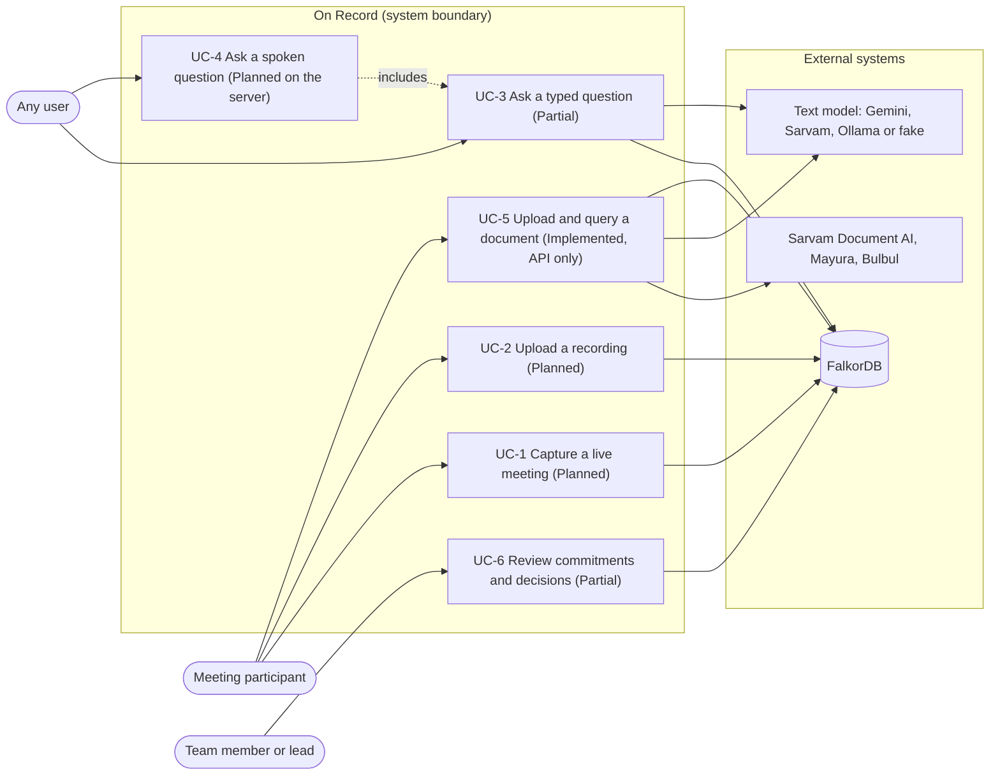

# Software requirements specification

This specification follows the outline of ISO/IEC/IEEE 29148:2018 for a software requirements specification (SRS). It describes On Record as the repository stands at commit `8943885`. Every line number cited below is valid at that commit.

## 1. Introduction

### 1.1 Purpose

The SRS states what On Record is required to do and how well, and records for each requirement whether the code meets it today. It is the reference for the design documents ([SDS](../design/SDS.md)), the [test plan](../testing/test-plan.md) and the [traceability matrix](../testing/traceability.md).

### 1.2 Scope

On Record listens to meetings, attributes speech to speakers, writes what was said into a graph, extracts decisions and action items, and answers questions with citations to the moment something was said. A separate documents service digitises, searches, translates and reads documents aloud. The product name comes from `brand.json:2`.

The repository has two apps: a Python API (`apps/api`) and a React web app (`apps/web`). See [the two apps](../ARCHITECTURE.md#the-two-apps) and [what is not in the repository yet](../ARCHITECTURE.md#what-is-not-in-the-repository-yet).

### 1.3 Definitions

Terms (utterance, speaker track, supersession, RRF, demo mode and others) are defined in the [glossary](../glossary.md). Acronyms used here: ASR (automatic speech recognition), VAD (voice activity detection), SSE (Server-Sent Events), RRF (reciprocal-rank fusion), LLM (large language model), WER (word error rate).

**Status values.** *Implemented*: the code exists and a client of this repository can reach it end to end (documents through the standalone `wsw_brain.documents.app`). *Partial*: the code exists but is not wired end to end; the row says what is missing. *Planned*: only the web client, `.env.example` or the docs expect it.

**Verification.** *Test*: automated pytest. *Inspection*: code or document review. *Demonstration*: running the app.

### 1.4 References

[README](../../README.md), [architecture](../ARCHITECTURE.md), [configuration](../CONFIGURATION.md), [design](../DESIGN.md), [troubleshooting](../TROUBLESHOOTING.md), [upstream](../UPSTREAM.md), [local Gemma](../LOCAL_GEMMA.md), [web app README](../../apps/web/README.md), [REST API reference](../api/README.md).

### 1.5 Status summary

| | Implemented | Partial | Planned | Total |
| --- | --- | --- | --- | --- |
| Functional requirements (FR) | 26 | 35 | 4 | 65 |
| Quality requirements (NFR) | 16 | 9 | 3 | 28 |

Most Partial requirements have working, tested code that nothing runs yet: the four gaps listed in [2.1 Product perspective](#21-product-perspective) explain why, chiefly the missing meeting routes (G1) and the unwired ingest pipeline (G4). The [traceability matrix](../testing/traceability.md) maps each requirement to its code and tests.

## 2. Product overview

### 2.1 Product perspective

On Record is self-contained. It depends on FalkorDB for storage (`docker-compose.yml:1-13`), on one text model chosen at start-up (`apps/api/wsw_brain/brain/llm.py:856-895`), and optionally on Sarvam for documents, translation and speech.

Four facts limit what is reachable today. Rows below refer to them by these labels:

- **G1.** The main app mounts only the SSE stream, three status routes and, when injected, the agent. It has no meeting routes, no voice routes and no WebSocket (`apps/api/wsw_brain/app.py:14-41`).
- **G2/G3.** The web app probes `/api/health`, which no server serves, so it runs on demo data unless forced (`apps/web/src/api/mode.ts:25-27`). It posts questions to `/api/ask` (`apps/web/src/api/client.ts:94`), while the agent is mounted at `/api/agent/ask` only when injected (`apps/api/wsw_brain/app.py:19-20`, `apps/api/wsw_brain/app.py:44`).
- **G4.** `IngestPipeline` (`apps/api/wsw_brain/ingest/pipeline.py:55`, PR #75) is the only production caller of the graph insight writer, the extractor and the summariser, and the only production publisher of bus events. No entrypoint constructs it: not `apps/api/wsw_brain/app.py`, not `apps/api/wsw_brain/cli.py`, not any script ("No HTTP route starts the pipeline yet", `README.md:346`).
- **G7.** The PR #76 `GemmaClient` (`apps/api/wsw_brain/brain/gemma.py:81`) is used only by `apps/api/scripts/bench_gemma.py:18` and tests. The server selects models through `get_llm()` (`apps/api/wsw_brain/brain/llm.py:891`).

Two more apply to single features: SSE frames carry only the payload, while the client expects a whole event (G5, `apps/api/wsw_brain/routes/event_stream.py:22-23`, `apps/web/src/api/events.ts:94`), and documents are served only by `apps/api/wsw_brain/documents/app.py:21-25` (G6).

### 2.2 Product functions

Meeting capture and listening, speaker attribution, transcription, extraction and summaries, graph memory, retrieval and Ask, documents, translation and speech, live updates, web pages with a demo mode, and configuration of model providers. Section 3 lists them.

### 2.3 User classes

| Class | Uses | Source |
|---|---|---|
| Meeting participant (organiser) | Starts or uploads a meeting, names speakers | `apps/web/src/components/meeting/StartMeeting.tsx:28` |
| Any user | Asks typed or spoken questions | `apps/web/src/components/ask/AskDrawer.tsx:296` |
| Team member or lead | Reviews commitments, decisions, people and the graph | `apps/web/src/App.tsx:43-46` |
| Operator or developer | Configures providers, runs the API, benchmarks Gemma | `apps/api/wsw_brain/cli.py:11-31`, `apps/api/scripts/bench_gemma.py:1-127` |

### 2.4 Constraints

Python 3.12-3.13 with locked dependencies (`apps/api/pyproject.toml:6`); FalkorDB as the only database (`apps/api/wsw_brain/graph/store.py:1-13`); all settings from environment variables ([configuration](../CONFIGURATION.md)); English-only full-text terms, with substring matching for Indian scripts in documents (`apps/api/wsw_brain/graph/text.py:101-121`, `apps/api/wsw_brain/documents/store.py:21-24`).

### 2.5 Assumptions and dependencies

Docker is available for FalkorDB. Local models (faster-whisper, sherpa-onnx, EmbeddingGemma) are downloaded on first use. Hosted features assume a `GEMINI_API_KEY` or `SARVAM_API_KEY`. Hosting of the public demo site is not recorded in the repository.

## 3. Functional requirements

Requirement text is abridged; the cited code holds the full behaviour and limits. Tests for each row are mapped in the [traceability matrix](../testing/traceability.md).

### 3.1 Meeting capture and listening

| ID | Requirement | Status | Evidence | Verification |
|---|---|---|---|---|
| FR-001 | Segment a 16 kHz mono stream with Silero VAD on a worker thread; refuse audio beyond 300 s of backlog (`ListenerOverloaded`). | Partial: library only (G1, G4) | `apps/api/wsw_brain/listen/session.py:196-221` | Test |
| FR-002 | Capture browser microphone audio as 100 ms PCM16 frames and stream them to `/ws/meetings/{id}/audio`. | Planned: no server WebSocket | `apps/web/src/audio/mic.ts:34-36`, `apps/web/src/api/client.ts:112-118` | Inspection |
| FR-003 | Record a growing 16-bit WAV and serve it at `/api/meetings/{id}/audio`. | Partial: no audio route | `apps/api/wsw_brain/listen/audio.py:215-282` | Test |
| FR-004 | Process an audio file as a stream (`fast` or `realtime`), at most 2 h and 2 files at once, cancellable. | Partial: `process_file` has no caller | `apps/api/wsw_brain/listen/file_pipeline.py:27-113` | Test |
| FR-005 | Upload a recording from the Meetings page. | Planned: `/api/meetings/upload` not served | `apps/web/src/components/meeting/UploadRecording.tsx:42` | Inspection |
| FR-006 | Create, end, list, read and delete meetings in the graph. | Partial: no `/api/meetings` routes (G1) | `apps/api/wsw_brain/graph/store.py:267-342` | Test |
| FR-007 | Report listener state and lag at most every 2 s and survive ASR or callback failures. | Partial: `listener.status` published only by the unwired pipeline (G4) | `apps/api/wsw_brain/listen/session.py:641-662`, `apps/api/wsw_brain/ingest/pipeline.py:151-157` | Test |

### 3.2 Speaker attribution

| ID | Requirement | Status | Evidence | Verification |
|---|---|---|---|---|
| FR-008 | Assign speech to tracks `S1`, `S2`, … by online clustering of voice embeddings (threshold 0.55, at most 8 speakers), with a confidence. | Partial: library only (G4) | `apps/api/wsw_brain/listen/speakers.py:71-186` | Test |
| FR-009 | Split a segment at voice changes, hold ambiguous parts, merge converging tracks. | Partial: library only | `apps/api/wsw_brain/listen/speakers.py:283-357` | Test |
| FR-010 | Continue a meeting's speaker tracks in a later session. | Partial: library only | `apps/api/wsw_brain/listen/session.py:595-635` | Test |
| FR-011 | Name a speaker (link to `Person`, update owners) and merge speakers in the graph. | Partial: rename route not served | `apps/api/wsw_brain/graph/store.py:397-459` | Test |

### 3.3 Transcription

| ID | Requirement | Status | Evidence | Verification |
|---|---|---|---|---|
| FR-012 | Transcribe turns locally with faster-whisper and drop hallucination phrases on quiet or low-confidence audio. | Partial: never constructed; ASR settings unread | `apps/api/wsw_brain/listen/asr.py:14-97` | Test |
| FR-013 | Transcribe Indian-language and code-mixed audio with Sarvam Saaras v4 in windows of 28 s or less. | Partial: not wired (G4) | `apps/api/wsw_brain/listen/sarvam_asr.py:31-124` | Test |
| FR-014 | Accept a spoken question at `/api/ask/voice`, transcribe it and answer. | Partial: `GemmaClient.transcribe` exists but is unwired (G7); no voice route; every `LLM.transcribe` raises `NotImplementedError` | `apps/api/wsw_brain/brain/gemma.py:169-186`, `apps/api/wsw_brain/brain/llm.py:278-279` | Test |

### 3.4 Extraction and summaries

| ID | Requirement | Status | Evidence | Verification |
|---|---|---|---|---|
| FR-015 | Extract decisions, action items, topics, entities and mentions from a window, keeping only evidence ids in the window. | Partial: called only by the unwired pipeline (G4) | `apps/api/wsw_brain/brain/extract.py:199-344`, `apps/api/wsw_brain/ingest/pipeline.py:419` | Test |
| FR-016 | Fall back to cue-phrase extraction and report the reason. | Partial: as FR-015 | `apps/api/wsw_brain/brain/extract.py:698-715` | Test |
| FR-017 | Mark a decision superseded by a later one from any meeting; a restatement does not supersede. | Partial: reached only through the pipeline (G4) | `apps/api/wsw_brain/graph/store.py:555-578` | Test |
| FR-018 | Store insights in one locked, deduplicated write and return only new items. | Partial: called by the unwired pipeline (G4) | `apps/api/wsw_brain/graph/store.py:461-665` | Test |
| FR-019 | Summarise a meeting in at most 80 words, with a heuristic fallback. | Partial: pipeline unwired; only the seed script stores summaries | `apps/api/wsw_brain/brain/summary.py:15-123`, `apps/api/scripts/seed_demo_meetings.py:44-45` | Test |
| FR-060 | Run live extraction every `WSW_EXTRACT_EVERY` (6) utterances over windows of up to 14, without repeating restated items, publishing `insight.created`. | Partial: pipeline unwired (G4) | `apps/api/wsw_brain/ingest/pipeline.py:373-447` | Test |
| FR-061 | On meeting end, flush, mark ended, run a final extraction and summary, publish `meeting.ended`; idempotent. | Partial: unwired; end route not served | `apps/api/wsw_brain/ingest/pipeline.py:186-240` | Test |

### 3.5 Graph memory

| ID | Requirement | Status | Evidence | Verification |
|---|---|---|---|---|
| FR-020 | Write utterances in one batch with Meeting, Speaker and Utterance nodes and NEXT edges, even out of order. | Partial: written by the unwired pipeline and the seed script | `apps/api/wsw_brain/graph/store.py:345-395` | Test |
| FR-021 | Create indexes idempotently and refuse an embedder of a different dimension. | Implemented | `apps/api/wsw_brain/graph/store.py:213-247` | Test |
| FR-022 | Provide read models for action items, decisions, people, "who knows", subgraphs and counts. | Partial: no routes served | `apps/api/wsw_brain/graph/store.py:676-789` | Test |
| FR-023 | Persist conversation turns per session. | Partial: unused; route not served | `apps/api/wsw_brain/graph/store.py:889-907` | Test |
| FR-062 | Write listener utterances as they arrive in micro-batches (8 or 1 s), keep text when embedding fails, retry FalkorDB 3 times, publish `utterance.created` and `graph.write`. | Partial: no entrypoint constructs the pipeline or feeds it from a `LiveSession` (G4) | `apps/api/wsw_brain/ingest/pipeline.py:251-361` | Test |

### 3.6 Retrieval and Ask

| ID | Requirement | Status | Evidence | Verification |
|---|---|---|---|---|
| FR-024 | Retrieve evidence by fusing full-text, vector, named speakers and recency with RRF (k=60); a failed source does not sink the others. | Implemented: through `/api/documents/ask` with `include_meetings` | `apps/api/wsw_brain/brain/retrieve.py:29-122` | Test |
| FR-025 | Exclude vectors from a different embedder (re-embedding check, cached 600 s). | Implemented | `apps/api/wsw_brain/brain/retrieve.py:124-172` | Test |
| FR-026 | Sanitise full-text queries and fall back to a substring scan. | Implemented | `apps/api/wsw_brain/graph/store.py:793-815` | Test |
| FR-027 | Answer only from evidence with `[u:<id>]` citations, dropping foreign ids, with trace, Cypher and timings. | Partial: agent mounted only when injected (G3) | `apps/api/wsw_brain/brain/agent.py:38-94` | Test |
| FR-028 | Keep the last 6 exchanges per session as context. | Partial: in memory; unwired (G3) | `apps/api/wsw_brain/brain/agent.py:96-103` | Test |
| FR-029 | Provide an Ask drawer for scoped typed questions with playable citations. | Partial: live mode calls unserved `/api/ask` | `apps/web/src/components/ask/AskDrawer.tsx:157-216` | Demonstration |
| FR-030 | Record spoken questions (≤30 s) by hold, toggle or hands-free, with barge-in. | Partial: sending needs `/api/ask/voice` | `apps/web/src/components/ask/useVoiceQuestion.ts:1-4` | Demonstration |
| FR-031 | Optionally read answers aloud with browser speech synthesis. | Implemented | `apps/web/src/components/ask/speech.ts:1-5` | Demonstration |

### 3.7 Documents

All rows are served only by `wsw_brain.documents.app` (G6).

| ID | Requirement | Status | Evidence | Verification |
|---|---|---|---|---|
| FR-032 | Accept PDF, PNG, JPEG or ZIP up to 25 MB and 100 pages, detect type from magic bytes, split into parts of ≤10 pages. | Implemented | `apps/api/wsw_brain/documents/split.py:73-177` | Test |
| FR-033 | Digitise parts with Sarvam Document AI, polling and retrying. | Implemented | `apps/api/wsw_brain/documents/sarvam.py:51-162` | Test |
| FR-034 | Chunk pages into passages of ≤1200 characters, embed and store them. | Implemented | `apps/api/wsw_brain/documents/store.py:174-219` | Test |
| FR-035 | Run ingestion as a background job with progress, listing and deletion. | Implemented | `apps/api/wsw_brain/routes/documents.py:159-226` | Test |
| FR-036 | Add a Gemma 4 description to uploaded images. | Implemented | `apps/api/wsw_brain/documents/vision.py:15-43` | Test |
| FR-037 | Search documents with full-text and vectors; Indian scripts by substring. | Implemented | `apps/api/wsw_brain/documents/store.py:252-286` | Test |
| FR-038 | Answer only from passages with `[d:…]` citations, optionally with meetings, noting conflicts and which is newer. | Implemented | `apps/api/wsw_brain/documents/answer.py:118-194` | Test |
| FR-039 | Summarise each document without failing ingestion. | Implemented | `apps/api/wsw_brain/documents/answer.py:197-213` | Test |
| FR-040 | Provide a Documents page in the web app. | Planned: absent on main | `apps/web/src/App.tsx:40-47` | Inspection |

### 3.8 Translation and speech

| ID | Requirement | Status | Evidence | Verification |
|---|---|---|---|---|
| FR-041 | Translate a document answer into an `xx-IN` language; on failure or 20 s return English with `translation_error`. | Implemented | `apps/api/wsw_brain/sarvam.py:34-106` | Test |
| FR-042 | Read text aloud with Sarvam Bulbul v3 and return `audio/wav`. | Implemented | `apps/api/wsw_brain/sarvam.py:108-130` | Test |

### 3.9 Live updates

| ID | Requirement | Status | Evidence | Verification |
|---|---|---|---|---|
| FR-043 | Provide an in-process event bus with 500-event replay and bounded subscriber queues. | Implemented: only publisher is the unwired pipeline (G4) | `apps/api/wsw_brain/events.py:1-139` | Test |
| FR-044 | Stream events at `GET /api/events` as SSE with `since_id` and keep-alive. | Implemented | `apps/api/wsw_brain/routes/event_stream.py:14-67` | Test |
| FR-045 | Consume events in the web app with backoff and update the views. | Partial: frame mismatch (G5); no publisher runs | `apps/web/src/api/events.ts:23-100` | Inspection |

### 3.10 Web app pages and demo mode

| ID | Requirement | Status | Evidence | Verification |
|---|---|---|---|---|
| FR-046 | Decide live or demo mode once before first render. | Implemented: falls back to demo (G2) | `apps/web/src/api/mode.ts:1-32` | Demonstration |
| FR-047 | Serve two scripted meetings in demo mode and refuse server-only features with 503. | Implemented | `apps/web/src/api/demo/demoApi.ts:361-441` | Demonstration |
| FR-048 | Meetings page with start, upload and totals. | Partial: demo data only | `apps/web/src/pages/MeetingsPage.tsx:25-118` | Demonstration |
| FR-049 | Meeting room with lanes, transcript, insights, audio and capture. | Partial: capture, end, rename and audio need unserved routes | `apps/web/src/pages/MeetingRoom.tsx:93` | Demonstration |
| FR-050 | Commitments page with filters and an optimistic done toggle. | Partial: demo writes only | `apps/web/src/pages/CommitmentsPage.tsx:44-147` | Demonstration |
| FR-051 | Decisions page with supersession chains and evidence. | Partial: demo data only | `apps/web/src/pages/DecisionsPage.tsx:162-211` | Demonstration |
| FR-052 | People page and "Who knows about…" search. | Partial: demo data only | `apps/web/src/pages/PeoplePage.tsx:168-253` | Demonstration |
| FR-053 | Graph page for one meeting or the whole graph. | Partial: demo data only | `apps/web/src/pages/GraphPage.tsx:20` | Demonstration |
| FR-054 | Command palette (Ctrl/Cmd+K). | Implemented | `apps/web/src/components/CommandPalette.tsx:59` | Demonstration |

### 3.11 Configuration and providers

| ID | Requirement | Status | Evidence | Verification |
|---|---|---|---|---|
| FR-055 | Read and validate all settings from the environment or `.env`. | Implemented | `apps/api/wsw_brain/config.py:15-93` | Test |
| FR-056 | Select the text model from `WSW_LLM_PROVIDER` (`auto`: Gemini, Sarvam, Ollama, fake). | Implemented | `apps/api/wsw_brain/brain/llm.py:856-895` | Test |
| FR-057 | Embed with EmbeddingGemma-300m on the CPU, falling back to hashing. | Implemented | `apps/api/wsw_brain/brain/embed.py:18-186` | Test |
| FR-058 | Expose `/healthz`, `/api/status`, `/api/capabilities`; start with Uvicorn from the CLI. | Implemented (`/api/capabilities` lists `documents`, which the main app does not mount) | `apps/api/wsw_brain/app.py:22-39`, `apps/api/wsw_brain/cli.py:11-31` | Test |
| FR-059 | Use the declared question-audio, ASR, seed and access-control settings. | Planned: declared but unread (`WSW_EXTRACT_EVERY` is now read, see FR-060) | `apps/api/wsw_brain/config.py:63-69`, `.env.example:56-61` | Inspection |
| FR-063 | Provide a provider-neutral `GemmaClient` (Ollama, Gemini REST, OpenAI-compatible) with schema-validated JSON, health check and native-audio transcription. | Partial: used only by the benchmark and tests (G7) | `apps/api/wsw_brain/brain/gemma.py:1-337` | Test |
| FR-064 | Provide a repeatable structured-output smoke benchmark over `gemma-smoke-v1` (5 cases). | Implemented (developer CLI) | `apps/api/scripts/bench_gemma.py:1-127`, `apps/api/benchmarks/gemma_smoke.json:1-31` | Test |
| FR-065 | Provide `apps/api/scripts/gemma.sh` to start Ollama and pull the Gemma model. | Implemented (developer script) | `apps/api/scripts/gemma.sh:1-40` | Inspection |

**Functional requirement totals:** 65 (Implemented 26, Partial 35, Planned 4).

## 4. Quality requirements

| ID | Group | Requirement | Status | Evidence | Verification |
|---|---|---|---|---|---|
| NFR-001 | Performance | Medians quoted in the repo on an M1 Max with Gemma 4 E4B: line in the graph 2.2 s, typed answer 5.1 s, spoken question +0.7 s. | Planned (claim only; the paths are unwired, measurement scripts not in the repo) | `apps/web/src/landing/LinerNotes.tsx:20-25` | Demonstration |
| NFR-002 | Accuracy | Speaker attribution 100%/100%, diarization error 0.0%/0.3%, WER 3.2%/3.1%, with the caveat "synthetic voices, so treat accuracy as an upper bound". | Planned (claim only) [unverified provenance] | `apps/web/src/landing/LinerNotes.tsx:14-18`, `apps/web/src/landing/LinerNotes.tsx:105-107` | Demonstration |
| NFR-003 | Performance | Bound model calls: 2 slots, 6 waiting, 90 s wait; priority work first. | Implemented | `apps/api/wsw_brain/brain/llm.py:58-164` | Test |
| NFR-004 | Resources | Bound listener memory and backlog (300 s queue, 2 files, 2 h). | Partial: library only (G4) | `apps/api/wsw_brain/listen/session.py:11-17` | Test |
| NFR-005 | Privacy, local-first | Run without sending meeting data off the machine (Ollama, faster-whisper, CPU embeddings, fake LLM, FalkorDB in Docker). | Partial: local text path works; listener and ingest unwired; documents need Sarvam | `apps/api/wsw_brain/brain/llm.py:875-887`, `apps/api/scripts/gemma.sh:1-40` | Test |
| NFR-006 | Privacy | Send data only to the configured provider; Sarvam key only to its base URL; bind to loopback by default. | Implemented | `apps/api/wsw_brain/documents/sarvam.py:52`, `apps/api/wsw_brain/cli.py:24`, `docker-compose.yml:5` | Inspection |
| NFR-007 | Cost | Need no paid service for the core text path; hosted services are opt-in by key. Prices are not recorded in the repository. | Implemented | `apps/api/wsw_brain/brain/llm.py:856-887`, `apps/api/wsw_brain/brain/embed.py:182-186` | Test |
| NFR-008 | Reliability, fallbacks | Degrade retrieval gracefully when a source or the vector index fails. | Implemented | `apps/api/wsw_brain/brain/retrieve.py:209-218` | Test |
| NFR-009 | Reliability, fallbacks | Fall back to heuristics for extraction and summaries; store documents when a summary fails. | Partial: meeting fallbacks run only in the unwired pipeline | `apps/api/wsw_brain/brain/extract.py:709-715`, `apps/api/wsw_brain/documents/ingest.py:155-160` | Test |
| NFR-010 | Reliability | Graph timeouts (3 s connect, 60 s reply), one retry, 503 from the documents API. | Implemented | `apps/api/wsw_brain/graph/store.py:139-191` | Test |
| NFR-011 | Reliability | Explicit timeouts and bounded retries for hosted calls. | Implemented | `apps/api/wsw_brain/documents/sarvam.py:118-151`, `apps/api/wsw_brain/brain/llm.py:40` | Test |
| NFR-012 | Reliability | Survive reconnects with replay and client backoff. | Partial: client cannot read frames (G5) | `apps/api/wsw_brain/events.py:101-109` | Test |
| NFR-026 | Reliability | Keep utterances through transient failures in live ingest. | Partial: pipeline unwired (G4) | `apps/api/wsw_brain/ingest/pipeline.py:320-347` | Test |
| NFR-013 | Security | Mark outside material as untrusted in every prompt (`UNTRUSTED_NOTE`). | Implemented | `apps/api/wsw_brain/brain/llm.py:35-39` | Test |
| NFR-014 | Integrity | Cite only retrieved or in-window evidence. | Partial: Implemented for documents; agent and extractor unwired | `apps/api/wsw_brain/documents/answer.py:155-157`, `apps/api/wsw_brain/brain/agent.py:148-163` | Test |
| NFR-015 | Security | Parameterise all Cypher values; redact connection URLs. | Implemented | `apps/api/wsw_brain/graph/cypher.py:1-2`, `apps/api/wsw_brain/graph/store.py:1180-1181` | Inspection |
| NFR-016 | Input validation | Bound and validate questions, uploads and images. | Implemented | `apps/api/wsw_brain/routes/agent.py:13-17`, `apps/api/wsw_brain/routes/documents.py:114-121` | Test |
| NFR-017 | Security | Protect mutating routes with a token, limits and allowed hosts; restrict CORS. | Planned: no authentication; documents CORS is `*` | `.env.example:56-61`, `apps/api/wsw_brain/documents/app.py:22-24` | Inspection |
| NFR-027 | Security | Send hosted API keys only in headers or the SDK, never in URLs. | Partial: `GemmaClient` puts the Gemini key in `?key=` (benchmark only, G7) | `apps/api/wsw_brain/brain/gemma.py:239` | Inspection |
| NFR-018 | Accessibility | Dialogs use `role="dialog"`, trap focus and close on Escape. | Implemented | `apps/web/src/components/ask/useFocusTrap.ts:1-2` | Demonstration |
| NFR-019 | Accessibility | Keyboard access: `/`, Ctrl/Cmd+K, Space for talkback, skip link. | Implemented | `apps/web/src/components/shell/AppShell.tsx:143` | Demonstration |
| NFR-020 | Accessibility | Respect `prefers-reduced-motion`. | Implemented | `apps/web/src/styles/base.css:335-340` | Demonstration |
| NFR-021 | Accessibility | Announce dynamic content (`aria-live`, `role="alert"`, `aria-sort`). | Implemented | `apps/web/src/pages/CommitmentsPage.tsx:186` | Demonstration |
| NFR-022 | Maintainability | Backend tests in CI against a real FalkorDB, plus ruff. | Implemented | `.github/workflows/checks.yml:16-57` | Test |
| NFR-023 | Maintainability | Type-check and lint the web app in the checks. | Partial: CI does not run them; no web tests | `apps/web/package.json:6-11` | Inspection |
| NFR-024 | Maintainability | Define shared shapes once and mirror them; keep Cypher in one module. | Partial: hand-kept mirror, some docstrings out of date | `apps/web/src/api/types.ts:1-2`, `apps/api/wsw_brain/contracts.py:275` | Inspection |
| NFR-025 | Portability | Python 3.12-3.13, locked dependencies, FalkorDB 4.x and 6.0.x, Windows. | Implemented (6.0.x asserted in comments only) [unverified by CI] | `apps/api/pyproject.toml:6`, `.github/workflows/checks.yml:35` | Inspection |
| NFR-028 | Reproducibility | Versioned smoke corpus and a report recording corpus, time, Python, provider and model. | Implemented | `apps/api/scripts/bench_gemma.py:64-89` | Test |

**Quality requirement totals:** 28 (Implemented 16, Partial 9, Planned 3).

## 5. External interfaces

| Interface | Description | Status | Reference |
|---|---|---|---|
| User interface | React web app: Meetings, meeting room, Commitments, Decisions, People, Graph, Ask drawer, command palette | Implemented on demo data (G2) | [web README](../../apps/web/README.md), [design](../DESIGN.md) |
| REST | Status routes, agent Ask (when injected), documents app | Partial | [API reference](../api/README.md), `apps/api/wsw_brain/app.py:14-41` |
| SSE | `GET /api/events` | Implemented (frame mismatch, G5) | [live updates](../ARCHITECTURE.md#live-updates) |
| Audio | WebSocket PCM16 capture and WAV playback | Planned on the server | [audio](../ARCHITECTURE.md#audio), `apps/web/src/audio/mic.ts:34-36` |
| Sarvam | Document AI, Mayura and sarvam-translate, Bulbul, Saaras, chat | Implemented for documents; Saaras unwired | `apps/api/wsw_brain/documents/sarvam.py:51-162`, `apps/api/wsw_brain/sarvam.py:12-27` |
| Gemini | Text and image model through the SDK; REST in `GemmaClient` | Implemented through `get_llm()` | `apps/api/wsw_brain/brain/llm.py:346` |
| Ollama | Local text model; native audio only in `GemmaClient` | Implemented through `get_llm()`; audio unwired (G7) | `apps/api/wsw_brain/brain/llm.py:875-887`, [local Gemma](../LOCAL_GEMMA.md) |
| FalkorDB | Graph store and indexes through `GraphStore` | Implemented | [graph schema](../ARCHITECTURE.md#graph-schema), `apps/api/wsw_brain/graph/store.py:139-191` |

## 6. Use cases

*UML use-case view of On Record: three user classes, six use cases with their status at `8943885`, and the external systems each one depends on.*

Sources: `apps/web/src/components/meeting/StartMeeting.tsx:28`, `apps/web/src/components/meeting/UploadRecording.tsx:42`, `apps/web/src/components/ask/AskDrawer.tsx:296`, `apps/web/src/components/ask/useVoiceQuestion.ts:1-4`, `apps/api/wsw_brain/routes/documents.py:159`, `apps/web/src/App.tsx:43-46`, `apps/api/wsw_brain/brain/llm.py:856-895`, `apps/api/wsw_brain/app.py:14-41`, `apps/api/wsw_brain/ingest/pipeline.py:55`.

| UC | Actor and trigger | Main flow | Key alternate flows | Related FRs | Status |
|---|---|---|---|---|---|
| UC-1 Capture a live meeting | Participant starts a meeting and capture (`apps/web/src/pages/MeetingRoom.tsx:93`) | Create meeting; stream PCM16 over WebSocket; listener segments, attributes and transcribes; `IngestPipeline` writes utterances and extracts every N; SSE updates the room; ending stores a final extraction and summary | Microphone denied (`apps/web/src/audio/mic.ts:38-53`); backlog over 300 s; reconnect keeps tracks; demo mode 503 | FR-001-FR-012, FR-015-FR-020, FR-043-FR-045, FR-048, FR-049, FR-060-FR-062 | Planned end to end: no meeting or socket routes (G1); pipeline exists but is not constructed (G4) |
| UC-2 Upload a recording | Participant picks a file (`apps/web/src/components/meeting/UploadRecording.tsx:25`) | Post file; decode in blocks through a `LiveSession`; store as in UC-1 | Over 2 h refused; cancel; more than 2 wait; demo mode 503 | FR-004-FR-006, FR-012, FR-015-FR-020, FR-048, FR-060-FR-062 | Planned end to end: no upload route; `process_file` and `IngestPipeline.callbacks()` (`apps/api/wsw_brain/ingest/pipeline.py:118-143`) are not joined |
| UC-3 Ask a typed question | Any user presses `/` or uses the palette | Post question; hybrid retrieval with RRF; cited answer; show trace and Cypher | No evidence: fixed fallback (`apps/api/wsw_brain/brain/agent.py:61-70`); model busy; stale request aborted; demo matching | FR-024-FR-029, FR-031, FR-054 | Partial: client calls unserved `/api/ask` (G3); demo mode works |
| UC-4 Ask a spoken question | Any user holds talkback or speaks hands-free | Record ≤30 s WAV; post to `/api/ask/voice`; transcribe; answer as UC-3; speak it; barge-in | Insecure page or microphone error (`apps/web/src/audio/question.ts:19-26`); empty transcript; demo 503 | FR-014, FR-024-FR-028, FR-030, FR-031, FR-063 | Planned on the server: no voice route; `GemmaClient.transcribe` unwired (G7). Browser capture and speech Implemented |
| UC-5 Upload and query a document | Client posts to `POST /api/documents` | Validate and split; background digitise, describe, chunk, embed, store, summarise; poll; ask with optional meetings and language; read aloud | No Sarvam key 503; too large 413; too many pages 400; job failed; translation error; graph 503 | FR-024, FR-032-FR-042 | Implemented (API only, G6); no web UI (FR-040 Planned) |
| UC-6 Review commitments and decisions | Team member opens `/commitments`, `/decisions`, `/people` or `/graph` | Load; filter and sort; play evidence; mark done; live refresh | Load error with retry; rollback on failed toggle (`apps/web/src/pages/CommitmentsPage.tsx:132-135`); demo changes lost on reload | FR-018, FR-022, FR-045-FR-047, FR-049-FR-053 | Partial: demo data only; read routes not served |
