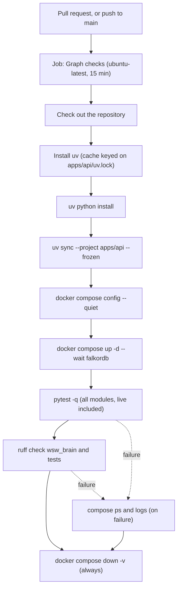

# Test plan

This plan describes how On Record is tested at commit `8943885`. Its structure follows the test plan outline of ISO/IEC/IEEE 29119-3 (software testing, part 3: test documentation), shortened to the parts this repository can support. Requirement IDs (FR for functional, NFR for quality) are those of the [software requirements specification](../requirements/SRS.md). The [traceability matrix](traceability.md) maps every ID to its design section, code and tests.

## Scope

In scope:

- The Python backend in `apps/api/wsw_brain`: listener, speaker attribution, transcription adapters, extraction and summaries, the ingest pipeline, graph store, retrieval, the meeting agent, the documents app, Sarvam speech and translation, the event bus and SSE stream, configuration, model adapters and the Gemma benchmark harness.
- The web app in `apps/web`, through type-checking, linting, building and the manual demo cases below.

Out of scope:

- Hosted providers (Gemini, Sarvam, OpenAI-compatible endpoints). The suite replaces them with mock transports or injected clients, so no test calls the network (README.md:301).
- Accuracy and speed figures quoted on the landing page (apps/web/src/landing/LinerNotes.tsx:14-25). No test asserts them (NFR-001, NFR-002).
- Hosting of the public demo site. Not recorded in the repository.

## Test levels

| Level | What it covers | Needs | How it is selected |
|---|---|---|---|
| Unit | Pure logic and adapters with fakes: fusion, extraction heuristics, the model gate, settings, event bus, HTTP adapters over mock transports, `IngestPipeline` over an in-memory store | Nothing outside Python | Default; no marker |
| Live-graph integration | `GraphStore`, hybrid retrieval and document ingest against a real FalkorDB | FalkorDB at `WSW_FALKORDB_URL` | Module-level `pytestmark = pytest.mark.live` (apps/api/tests/test_graph.py:23, apps/api/tests/test_graph_schema.py:19, apps/api/tests/test_retrieve_graph.py:15, apps/api/tests/test_documents_ingest.py:17); marker declared at apps/api/pyproject.toml:41-43 |
| Model-backed | `LiveSession` with the real Silero VAD and speaker-embedding models, and speaker embedder tests | ONNX model files on disk | Skip when the files are missing (apps/api/tests/test_session.py:41-44, apps/api/tests/test_speakers.py:40) |
| Web static checks | Type-check and production build (`tsc -b && vite build`), lint (`oxlint`) | Node and the web dependencies | `npm run build`, `npm run lint` (apps/web/package.json:6-11); not run in CI |
| Manual demonstration | Web pages on the bundled demo meetings | A browser | The cases in [Manual demo test cases](#manual-demo-test-cases) |

The live-graph modules behave differently when FalkorDB is not running: `test_graph.py` skips (apps/api/tests/test_graph.py:57), while the other three fail (README.md:116).

## Test inventory

Counts are `def test_` functions at `8943885`; parametrised cases are not counted. "Live" means FalkorDB is required; "Models" means the module skips without local model files.

| Test file | Tests | Features | Requirements | FalkorDB | Models |
|---|---|---|---|---|---|
| apps/api/tests/test_agent_api.py | 4 | Agent router, blank-question 422, mounting only when injected | FR-027, NFR-016 | No | No |
| apps/api/tests/test_agent.py | 4 | Grounded citations, session history, fallback without a model call | FR-027, FR-028, NFR-014 | No | No |
| apps/api/tests/test_app.py | 7 | `/healthz`, `/api/status`, capabilities, SSE frames, cursors, disconnect | FR-044, FR-045, FR-058, NFR-012 | No | No |
| apps/api/tests/test_asr.py | 9 | faster-whisper adapter with a stub model | FR-012 | No | No |
| apps/api/tests/test_audio.py | 13 | PCM16, decode and resample, duration limits, `WavAppender` | FR-003, FR-004 | No | No |
| apps/api/tests/test_bench_gemma.py | 1 | Benchmark report with the fake provider | FR-064, NFR-028 | No | No |
| apps/api/tests/test_cli.py | 3 | Uvicorn launch options, port validation | FR-058 | No | No |
| apps/api/tests/test_config.py | 5 | Settings bounds and validation | FR-055 | No | No |
| apps/api/tests/test_contracts.py | 15 | Utterance and insight validation, file ASR contract | FR-018, NFR-024 | No | No |
| apps/api/tests/test_documents_api.py | 11 | Split preview, upload jobs, job list and delete, translation, speak | FR-032, FR-035, FR-041, FR-042, NFR-010, NFR-016 | No | No |
| apps/api/tests/test_documents_ingest.py | 6 | Ingest with page numbers, no-match answer, meeting and document conflict, image description, Indian-script search | FR-033, FR-034, FR-036 to FR-039, NFR-009, NFR-014 | Yes | No |
| apps/api/tests/test_documents_sarvam.py | 10 | Document AI job lifecycle and retries, Sarvam text model | FR-033, FR-056, NFR-006, NFR-011 | No | No |
| apps/api/tests/test_documents_split.py | 11 | Type detection, PDF and ZIP splitting, chunking | FR-032, FR-034, NFR-016 | No | No |
| apps/api/tests/test_embed.py | 7 | Hashing embedder | FR-057, NFR-005 | No | No |
| apps/api/tests/test_events.py | 12 | Event bus replay, filters, queue drop | FR-043, NFR-012 | No | No |
| apps/api/tests/test_extract.py | 8 | Heuristic and model extraction, track naming, fallbacks, untrusted prompt | FR-015 to FR-017, NFR-009, NFR-013, NFR-014 | No | No |
| apps/api/tests/test_gemini_llm.py | 13 | Gemini adapter, images, provider selection | FR-056, NFR-011, NFR-016 | No | No |
| apps/api/tests/test_gemma.py | 4 | `GemmaClient` native Ollama payload, JSON repair, fake, default models | FR-063 (FR-014 audio path not covered) | No | No |
| apps/api/tests/test_gemma_embed.py | 15 | EmbeddingGemma loader with tiny synthetic ONNX fixtures | FR-057, NFR-007 | No | No (fixtures) |
| apps/api/tests/test_graph_schema.py | 2 | Schema re-apply, full-text and vector queries | FR-021 | Yes | No |
| apps/api/tests/test_graph.py | 34 | `GraphStore` writes, merges, naming, insights, supersession, read models, turns | FR-006, FR-011, FR-017, FR-018, FR-020 to FR-023, FR-026, NFR-010, NFR-015, NFR-025 | Yes | No |
| apps/api/tests/test_llm.py | 22 | Ollama adapter, provider selection, fake model | FR-056, NFR-005, NFR-007, NFR-011 | No | No |
| apps/api/tests/test_model_gate.py | 7 | Model slots, priority, queue limits, timeouts | NFR-003 | No | No |
| apps/api/tests/test_openai_llm.py | 11 | OpenAI-compatible adapter and retries | FR-056, NFR-011 | No | No |
| apps/api/tests/test_pipeline.py | 7 | `IngestPipeline` with an in-memory store: batching, merges, embedding failure, live extraction, meeting end, forget, repeat filter | FR-060, FR-061, FR-062, NFR-026 | No | No |
| apps/api/tests/test_prompts.py | 1 | Every outside-material prompt carries the untrusted note | NFR-013 | No | No |
| apps/api/tests/test_retrieve_graph.py | 15 | Hybrid retrieval on real indexes, failure isolation, embedding-space checks | FR-024, FR-025, NFR-008 | Yes | No |
| apps/api/tests/test_retrieve.py | 5 | Reciprocal rank fusion, recency detection | FR-024 | No | No |
| apps/api/tests/test_sarvam_asr.py | 4 | Saaras windows, silence, keyterms | FR-013 | No | No |
| apps/api/tests/test_sarvam_speech.py | 10 | Translation routing, speech, WAV joining | FR-041, FR-042 | No | No |
| apps/api/tests/test_session.py | 16 | `LiveSession` and `process_file` on a two-speaker fixture | FR-001, FR-003, FR-004, FR-007 to FR-010, FR-012, NFR-004 | No | Yes |
| apps/api/tests/test_speakers.py | 14 | Online clustering, change points, merges | FR-008 to FR-010 | No | Partly |
| apps/api/tests/test_summary.py | 6 | Heuristic and model summaries, 80-word clip, priority | FR-019, NFR-003, NFR-009, NFR-013 | No | No |

Fixtures live in `apps/api/tests/fixtures` (a two-speaker WAV with its truth file, and synthetic ONNX models described in apps/api/tests/fixtures/README.md).

## How to run

The commands are in the [README checks section](../../README.md#checks) and are not repeated here. In short: start FalkorDB, run `pytest -q` from the API project, or deselect the live-graph modules with `-m "not live"` when no database is available. For database connection errors, model files that cause skips and other failures, see [TROUBLESHOOTING.md](../TROUBLESHOOTING.md).

## CI pipeline

*Activity view (as a flowchart) of the single "Graph checks" job that runs on every pull request and every push to `main`.*

Sources: .github/workflows/checks.yml:3-6, .github/workflows/checks.yml:16-19, .github/workflows/checks.yml:22-57.

The workflow has read-only contents permission and cancels superseded runs on the same ref (.github/workflows/checks.yml:8-13). Because FalkorDB is started before pytest, the live-graph modules run in CI. No step downloads the Silero VAD or speaker-embedding models, so the model-backed tests in `test_session.py` and `test_speakers.py` are expected to skip in CI [unverified: CI logs are not in the repository].

## Entry and exit criteria

- Entry: the branch installs with `uv sync --frozen`, and the Compose file validates.
- Exit: pytest and ruff pass in the "Graph checks" job. For changes to `apps/web`, `npm run build` and `npm run lint` pass locally and the manual demo cases relevant to the change have been run, since CI does not check the web app.

## Gaps and risks

| Gap | Effect | Related IDs |
|---|---|---|
| No web tests, and CI does not type-check, build or lint `apps/web` (.github/workflows/checks.yml:15-57; no `test` script in apps/web/package.json:6-11) | Web regressions are found only by hand | FR-029 to FR-031, FR-045 to FR-054, NFR-018 to NFR-021, NFR-023 |
| Routes the web client calls are not served by the main app, and no test checks the client against the server (apps/api/wsw_brain/app.py:14-41, apps/web/src/api/client.ts:59-118) | Live mode cannot work; nothing fails in CI | FR-002, FR-005, FR-006, FR-011, FR-022, FR-023, FR-029, FR-046 |
| The SSE frame carries only the payload while the client expects a whole event (apps/api/wsw_brain/event_stream.py:22-23, apps/web/src/api/events.ts:94). `test_app.py` pins the server side only | Live updates would be dropped by the client | FR-045, NFR-012 |
| `IngestPipeline` is tested only with an in-memory store, not against FalkorDB, and no test starts it from an entrypoint | The wiring gap (no entrypoint constructs it) is not detected | FR-060 to FR-062, NFR-026 |
| No test of Gemma native-audio transcription (apps/api/wsw_brain/brain/gemma.py:169-186) and no voice route to test | Spoken questions are unverified | FR-014, FR-030 |
| Model-backed listener tests are expected to skip in CI | Listener regressions may pass CI | FR-001, FR-007 to FR-010, NFR-004 |
| `scripts/gemma.sh`, access controls and key placement have no automated checks | Verified by inspection only | FR-065, NFR-017, NFR-027 |
| The FalkorDB 6.0.x engine is not exercised; CI uses the image pinned in docker-compose.yml:4 | Compatibility rests on code comments | NFR-025 |
| The hand-kept web type mirror (apps/web/src/api/types.ts:1) has no contract test | Drift between server and client shapes | NFR-024 |

## Manual demo test cases

Run the web app as described in [apps/web/README.md](../../apps/web/README.md) and open it with `?demo=1` to force demo data (apps/web/src/api/mode.ts:2). The bundled data holds two ended meetings, "Self-serve pricing review" and "Self-serve launch sync" (apps/web/src/api/demo/fixtures.json). Demo writes last until the page is reloaded (FR-047).

| ID | Requirement | Steps | Expected result |
|---|---|---|---|
| MT-1 | FR-046, FR-047, FR-048 | Open `/meetings?demo=1`. | Both demo meetings are listed, newest first. The system status says "Demo data". |
| MT-2 | FR-049 | Open "Self-serve pricing review". Select a decision's evidence. | Speaker lanes, transcript and insights show; the transport seeks to the evidence line. |
| MT-3 | FR-051 | Open the Decisions page. | The Starter-tier decision from the pricing review is shown as replaced by the decision from the launch sync (fixtures: `d-demo-pricing-review-1`, `superseded_by` `d-demo-launch-sync-1`), with proposer and evidence quotes. |
| MT-4 | FR-050, NFR-021 | Open Commitments, filter by an owner (for example Meera), mark one item done, then reload. | The item moves to done at once; after reload it is open again because demo writes are in memory only. |
| MT-5 | FR-029, NFR-019 | Press `/`, ask "What did we decide about pricing?" scoped to all meetings. Start a second question before the first returns. | The Ask drawer opens with focus inside it; an answer with citations appears; the first request is abandoned. |
| MT-6 | FR-030, FR-047 | In the Ask drawer, hold the talkback control and speak. | The question is refused with "Spoken questions need Gemma 4 on the API server. In this preview, type the question instead." (apps/web/src/api/demo/demoApi.ts:440). |
| MT-7 | FR-005, FR-047 | On Meetings, try to upload a recording or start a live meeting. | The action is refused with a 503 explanation that it needs the server. |
| MT-8 | FR-054, NFR-018 | Press Ctrl+K (Cmd+K on macOS), type "launch", choose the meeting, then reopen and press Escape. | The palette opens as a modal dialog, jumps to "Self-serve launch sync", and closes on Escape. |
